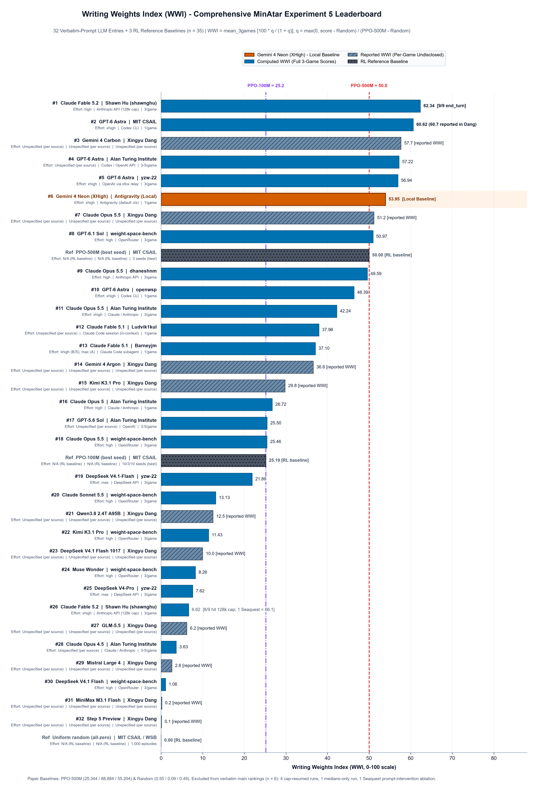
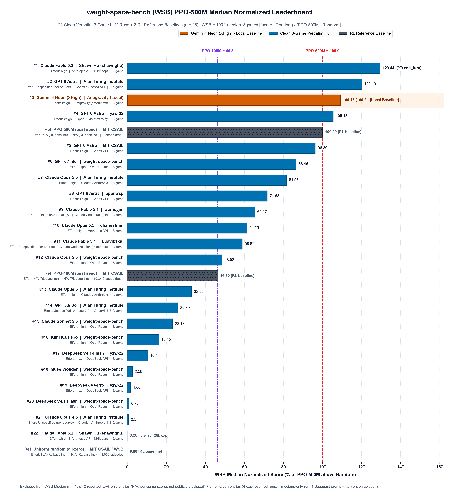
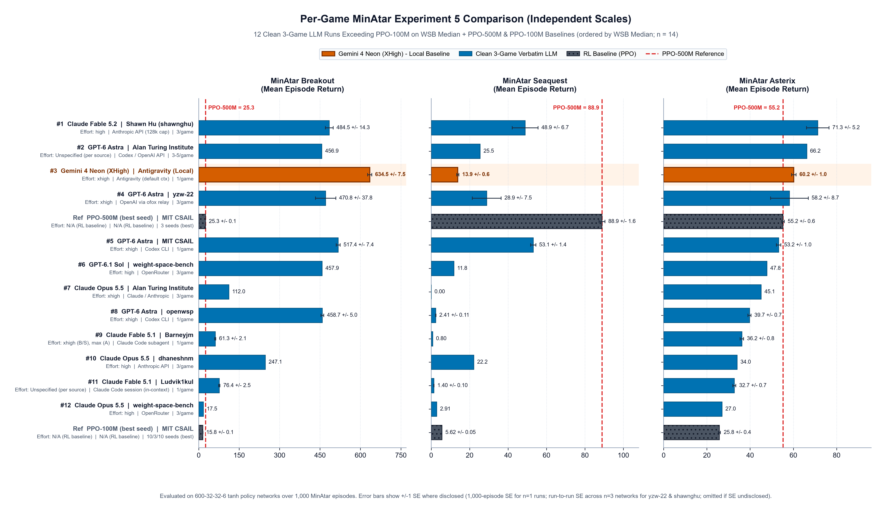

[English (README.md)](README.md) | [简体中文 (README.zh-CN.md)](README.zh-CN.md) | [Seaquest Prompt-Intervention Ablation (EN)](docs/prompt-intervention-ablation.md) | [Seaquest 提示词干预消融实验 (中文)](docs/prompt-intervention-ablation.zh-CN.md) | [LICENSE](LICENSE) | [THIRD_PARTY.md](THIRD_PARTY.md)

# Comprehensive Weight-Space Programming Leaderboard (MinAtar Experiment 5)

[%20%2B%20CC%20BY%204.0%20(docs%2Fdata)-blue.svg)](LICENSE)
[-orange.svg)](#4-key-highlights--methodology)
[](scripts/privacy_scan.py)

A unified, reproducible consolidation of **`41`** publicly reported **Weight-Space Programming (WSP) MinAtar Experiment 5** evaluations across `22` upstream sources (MIT CSAIL, Shawn Hu's `Claude Fable 5.2`, Xingyu Dang, `eomcaleb/weight-space-bench`, Alan Turing Institute `arXiv:2611.21449`, and community replications) alongside original local **Gemini 4 Neon (`xhigh`)** experiments—deterministically recomputed under both **Writing Weights Index (WWI)** and **`weight-space-bench` PPO-500M Median** formulas. *(See also our standalone [Seaquest 1-Sentence Prompt-Intervention Ablation](docs/prompt-intervention-ablation.md), which boosts Seaquest by `+29.66%` and doubles nonzero weights `550 -> 1,172`.)*

---

## 1. Writing Weights Index (WWI) Comprehensive Leaderboard



*Table 1 reproduces [`data/leaderboard_wwi.csv`](data/leaderboard_wwi.csv) (`include_in_main_wwi = True`: **32** verbatim-prompt LLM entries + **3** RL baselines = **35** main rows). Prompt-intervention ablation (`55.0657`) and protocol deviations are strictly isolated in [Section 5](#5-protocol-separated--non-comparable-results); formula definitions & baselines are in [Section 4](#4-key-highlights--methodology).*

| Rank | Model | Source | WWI | Score Type | Breakout | Seaquest | Asterix | Thinking Effort | Platform / API | Attempts |
|---:|---|---|---:|---|---:|---:|---:|---|---|---|
| 1 | **Claude Fable 5.2** | **Shawn Hu (shawnghu)** | **62.3367** | computed_wwi | **484.5283** | **48.8923** | **71.3117** | **high** | **Anthropic API (128k cap)** | **3/game** |
| 2 | GPT-6 Astra | MIT CSAIL | 60.6221 *(60.7 reported)* | computed_wwi | 517.4110 | 53.1100 | 53.1780 | xhigh | Codex CLI | 1/game |
| 3 | Gemini 4 Carbon | Xingyu Dang | 57.7000 | reported WWI | N/A (per-game scores not publicly disclosed) | N/A (per-game scores not publicly disclosed) | N/A (per-game scores not publicly disclosed) | Unspecified (per source) | Unspecified (per source) | Unspecified (per source) |
| 4 | GPT-6 Astra | Alan Turing Institute | 57.2207 | computed_wwi | 456.9000 | 25.5000 | 66.2000 | Unspecified (per source) | Codex / OpenAI API | 3-5/game |
| 5 | GPT-6 Astra | yzw-22 | 56.9405 | computed_wwi | 470.8000 | 28.9000 | 58.2000 | xhigh | OpenAI via ofox relay | 3/game |
| 6 | **Gemini 4 Neon (XHigh)** | **Antigravity (Local)** | **53.9532** | computed_wwi | **634.4770** | **13.8690** | **60.2170** | **xhigh** | **Antigravity (default ctx)** | **1/game** |
| 7 | Claude Opus 5.5 | Xingyu Dang | 51.2000 | reported WWI | N/A (per-game scores not publicly disclosed) | N/A (per-game scores not publicly disclosed) | N/A (per-game scores not publicly disclosed) | Unspecified (per source) | Unspecified (per source) | Unspecified (per source) |
| 8 | GPT-6.1 Sol | weight-space-bench | 50.9667 | computed_wwi | 457.8930 | 11.8240 | 47.7980 | high | OpenRouter | 3/game |
| Baseline | PPO-500M (best seed) | MIT CSAIL | 50.0000 *(50.0 reported)* | computed_wwi | 25.3440 | 88.8840 | 55.2040 | N/A (RL baseline) | N/A (RL baseline) | 3 seeds (best) |
| 9 | Claude Opus 5.5 | dhaneshnm | 49.5935 | computed_wwi | 247.0667 | 22.2000 | 34.0000 | high | Anthropic API | 3/game |
| 10 | GPT-6 Astra | openwsp | 46.3872 | computed_wwi | 458.7300 | 2.4070 | 39.7090 | xhigh | Codex CLI | 1/game |
| 11 | Claude Opus 5.5 | Alan Turing Institute | 42.2385 | computed_wwi | 112.0000 | 0.0000 | 45.1000 | xhigh | Claude / Anthropic | 3/game |
| 12 | Claude Fable 5.1 | Ludvik1kul | 37.9580 | computed_wwi | 76.4000 | 1.4000 | 32.7000 | Unspecified (per source) | Claude Code session (in-context) | 1/game |
| 13 | Claude Fable 5.1 | Barneyjm | 37.1004 | computed_wwi | 61.3000 | 0.8000 | 36.2000 | xhigh (B/S), max (A) | Claude Code subagent | 1/game |
| 14 | Gemini 4 Argon | Xingyu Dang | 36.6000 | reported WWI | N/A (per-game scores not publicly disclosed) | N/A (per-game scores not publicly disclosed) | N/A (per-game scores not publicly disclosed) | Unspecified (per source) | Unspecified (per source) | Unspecified (per source) |
| 15 | Kimi K3.1 Pro | Xingyu Dang | 29.8000 | reported WWI | N/A (per-game scores not publicly disclosed) | N/A (per-game scores not publicly disclosed) | N/A (per-game scores not publicly disclosed) | Unspecified (per source) | Unspecified (per source) | Unspecified (per source) |
| 16 | Claude Opus 5 | Alan Turing Institute | 26.7168 | computed_wwi | 30.9000 | 0.4000 | 18.5000 | high | Claude / Anthropic | 1/game |
| 17 | GPT-5.6 Sol | Alan Turing Institute | 25.4983 | computed_wwi | 31.1000 | 0.8000 | 14.6000 | Unspecified (per source) | OpenAI | 3-5/game |
| 18 | Claude Opus 5.5 | weight-space-bench | 25.4649 | computed_wwi | 17.5320 | 2.9070 | 27.0380 | high | OpenRouter | 3/game |
| Baseline | PPO-100M (best seed) | MIT CSAIL | 25.1852 *(25.2 reported)* | computed_wwi | 15.7790 | 5.6170 | 25.8200 | N/A (RL baseline) | N/A (RL baseline) | 10/3/10 seeds (best) |
| 19 | DeepSeek V4.1-Flash | yzw-22 | 21.8937 | computed_wwi | 32.1000 | 0.3000 | 6.2000 | max | DeepSeek API | 3/game |
| 20 | Claude Sonnet 5.5 | weight-space-bench | 13.1274 | computed_wwi | 6.5650 | 1.0300 | 13.1670 | high | OpenRouter | 3/game |
| 21 | Qwen3.8 2.4T A95B | Xingyu Dang | 12.5000 | reported WWI | N/A (per-game scores not publicly disclosed) | N/A (per-game scores not publicly disclosed) | N/A (per-game scores not publicly disclosed) | Unspecified (per source) | Unspecified (per source) | Unspecified (per source) |
| 22 | Kimi K3.1 Pro | weight-space-bench | 11.4312 | computed_wwi | 6.8100 | 0.2920 | 9.3290 | high | OpenRouter | 3/game |
| 23 | DeepSeek V4.1 Flash 1017 | Xingyu Dang | 10.0000 | reported WWI | N/A (per-game scores not publicly disclosed) | N/A (per-game scores not publicly disclosed) | N/A (per-game scores not publicly disclosed) | Unspecified (per source) | Unspecified (per source) | Unspecified (per source) |
| 24 | Muse Wonder | weight-space-bench | 8.2625 | computed_wwi | 7.4040 | 0.6440 | 1.8990 | high | OpenRouter | 3/game |
| 25 | DeepSeek V4-Pro | yzw-22 | 7.6170 | computed_wwi | 7.0000 | 0.6000 | 1.4000 | max | DeepSeek API | 3/game |
| 26 | Claude Fable 5.2 | Shawn Hu (shawnghu) | 6.6223 | computed_wwi | 0.5500 | 22.1040 | 0.4843 | xhigh | Anthropic API (128k cap) | 3/game |
| 27 | GLM-5.5 | Xingyu Dang | 6.2000 | reported WWI | N/A (per-game scores not publicly disclosed) | N/A (per-game scores not publicly disclosed) | N/A (per-game scores not publicly disclosed) | Unspecified (per source) | Unspecified (per source) | Unspecified (per source) |
| 28 | Claude Opus 4.5 | Alan Turing Institute | 3.6281 | computed_wwi | 3.4000 | 0.1000 | 0.8000 | Unspecified (per source) | Claude / Anthropic | 3-5/game |
| 29 | Mistral Large 4 | Xingyu Dang | 2.6000 | reported WWI | N/A (per-game scores not publicly disclosed) | N/A (per-game scores not publicly disclosed) | N/A (per-game scores not publicly disclosed) | Unspecified (per source) | Unspecified (per source) | Unspecified (per source) |
| 30 | DeepSeek V4.1 Flash | weight-space-bench | 1.0636 | computed_wwi | 0.7300 | 0.1730 | 1.8220 | high | OpenRouter | 3/game |
| 31 | MiniMax M3.1 Flash | Xingyu Dang | 0.2000 | reported WWI | N/A (per-game scores not publicly disclosed) | N/A (per-game scores not publicly disclosed) | N/A (per-game scores not publicly disclosed) | Unspecified (per source) | Unspecified (per source) | Unspecified (per source) |
| 32 | Step 5 Preview | Xingyu Dang | 0.1000 | reported WWI | N/A (per-game scores not publicly disclosed) | N/A (per-game scores not publicly disclosed) | N/A (per-game scores not publicly disclosed) | Unspecified (per source) | Unspecified (per source) | Unspecified (per source) |
| Baseline | Uniform random (all-zero) | MIT CSAIL / WSB | 0.0000 *(0.0 reported)* | computed_wwi | 0.5500 | 0.0900 | 0.4900 | N/A (RL baseline) | N/A (RL baseline) | 1,000 episodes |

---

## 2. `weight-space-bench` PPO-500M Median Normalized Leaderboard



*Table 2 reproduces [`data/leaderboard_wsb_median.csv`](data/leaderboard_wsb_median.csv) (`include_in_main_wsb = True`: **22** clean verbatim 3-game LLM runs + **3** RL baselines = **25** main rows). The `WSB Pub` column records the exact published value in `weight-space-bench/leaderboard/leaderboard.csv`.*

| Rank | Model | Source | WSB Median | WSB Pub | Breakout (% PPO-500M) | Seaquest (% PPO-500M) | Asterix (% PPO-500M) | Thinking Effort | Platform / API | Attempts |
|---:|---|---|---:|---:|---:|---:|---:|---|---|---|
| 1 | **Claude Fable 5.2** | **Shawn Hu (shawnghu)** | **129.4398** | — | **484.5283 (1952.00%)** | **48.8923 (54.96%)** | **71.3117 (129.44%)** | **high** | **Anthropic API (128k cap)** | **3/game** |
| 2 | GPT-6 Astra | Alan Turing Institute | 120.0972 | — | 456.9000 (1840.57%) | 25.5000 (28.62%) | 66.2000 (120.10%) | Unspecified (per source) | Codex / OpenAI API | 3-5/game |
| 3 | **Gemini 4 Neon (XHigh)** | **Antigravity (Local)** | **109.1622** | — | **634.4770 (2556.78%)** | **13.8690 (15.52%)** | **60.2170 (109.16%)** | **xhigh** | **Antigravity (default ctx)** | **1/game** |
| 4 | GPT-6 Astra | yzw-22 | 105.4757 | — | 470.8000 (1896.63%) | 28.9000 (32.45%) | 58.2000 (105.48%) | xhigh | OpenAI via ofox relay | 3/game |
| Baseline | PPO-500M (best seed) | MIT CSAIL | 100.0000 | 100.00 | 25.3440 (100.00%) | 88.8840 (100.00%) | 55.2040 (100.00%) | N/A (RL baseline) | N/A (RL baseline) | 3 seeds (best) |
| 5 | GPT-6 Astra | MIT CSAIL | 96.2971 | 96.30 | 517.4110 (2084.62%) | 53.1100 (59.71%) | 53.1780 (96.30%) | xhigh | Codex CLI | 1/game |
| 6 | GPT-6.1 Sol | weight-space-bench | 86.4642 | 86.46 | 457.8930 (1844.57%) | 11.8240 (13.21%) | 47.7980 (86.46%) | high | OpenRouter | 3/game |
| 7 | Claude Opus 5.5 | Alan Turing Institute | 81.5331 | — | 112.0000 (449.50%) | 0.0000 (-0.10%) | 45.1000 (81.53%) | xhigh | Claude / Anthropic | 3/game |
| 8 | GPT-6 Astra | openwsp | 71.6800 | — | 458.7300 (1847.95%) | 2.4070 (2.61%) | 39.7090 (71.68%) | xhigh | Codex CLI | 1/game |
| 9 | Claude Fable 5.1 | Barneyjm | 65.2667 | — | 61.3000 (245.02%) | 0.8000 (0.80%) | 36.2000 (65.27%) | xhigh (B/S), max (A) | Claude Code subagent | 1/game |
| 10 | Claude Opus 5.5 | dhaneshnm | 61.2458 | — | 247.0667 (994.26%) | 22.2000 (24.90%) | 34.0000 (61.25%) | high | Anthropic API | 3/game |
| 11 | Claude Fable 5.1 | Ludvik1kul | 58.8698 | — | 76.4000 (305.92%) | 1.4000 (1.48%) | 32.7000 (58.87%) | Unspecified (per source) | Claude Code session (in-context) | 1/game |
| 12 | Claude Opus 5.5 | weight-space-bench | 48.5214 | 48.52 | 17.5320 (68.49%) | 2.9070 (3.17%) | 27.0380 (48.52%) | high | OpenRouter | 3/game |
| Baseline | PPO-100M (best seed) | MIT CSAIL | 46.2953 | 46.30 | 15.7790 (61.42%) | 5.6170 (6.22%) | 25.8200 (46.30%) | N/A (RL baseline) | N/A (RL baseline) | 10/3/10 seeds (best) |
| 13 | Claude Opus 5 | Alan Turing Institute | 32.9166 | — | 30.9000 (122.41%) | 0.4000 (0.35%) | 18.5000 (32.92%) | high | Claude / Anthropic | 1/game |
| 14 | GPT-5.6 Sol | Alan Turing Institute | 25.7886 | — | 31.1000 (123.22%) | 0.8000 (0.80%) | 14.6000 (25.79%) | Unspecified (per source) | OpenAI | 3-5/game |
| 15 | Claude Sonnet 5.5 | weight-space-bench | 23.1696 | 23.17 | 6.5650 (24.26%) | 1.0300 (1.06%) | 13.1670 (23.17%) | high | OpenRouter | 3/game |
| 16 | Kimi K3.1 Pro | weight-space-bench | 16.1549 | 16.15 | 6.8100 (25.25%) | 0.2920 (0.23%) | 9.3290 (16.15%) | high | OpenRouter | 3/game |
| 17 | DeepSeek V4.1-Flash | yzw-22 | 10.4361 | — | 32.1000 (127.25%) | 0.3000 (0.24%) | 6.2000 (10.44%) | max | DeepSeek API | 3/game |
| 18 | Muse Wonder | weight-space-bench | 2.5752 | 2.57 | 7.4040 (27.64%) | 0.6440 (0.62%) | 1.8990 (2.58%) | high | OpenRouter | 3/game |
| 19 | DeepSeek V4-Pro | yzw-22 | 1.6632 | — | 7.0000 (26.01%) | 0.6000 (0.57%) | 1.4000 (1.66%) | max | DeepSeek API | 3/game |
| 20 | DeepSeek V4.1 Flash | weight-space-bench | 0.7260 | 0.75 | 0.7300 (0.73%) | 0.1730 (0.09%) | 1.8220 (2.43%) | high | OpenRouter | 3/game |
| 21 | Claude Opus 4.5 | Alan Turing Institute | 0.5666 | — | 3.4000 (11.49%) | 0.1000 (0.01%) | 0.8000 (0.57%) | Unspecified (per source) | Claude / Anthropic | 3-5/game |
| 22 | Claude Fable 5.2 | Shawn Hu (shawnghu) | 0.0000 | — | 0.5500 (0.00%) | 22.1040 (24.79%) | 0.4843 (-0.01%) | xhigh | Anthropic API (128k cap) | 3/game |
| Baseline | Uniform random (all-zero) | MIT CSAIL / WSB | 0.0000 | 0.00 | 0.5500 (0.00%) | 0.0900 (0.00%) | 0.4900 (0.00%) | N/A (RL baseline) | N/A (RL baseline) | 1,000 episodes |

### Tier-2 Disclosure: Models Reporting WWI Only (Excluded from WSB Median)
The following 10 models appear in Xingyu Dang's Writing Weights Index (`reported WWI`) without publicly disclosed per-game returns, so their WSB Median and all three game columns are strictly marked `N/A (per-game scores not publicly disclosed)`:

| Model | Source | Reported WWI | WSB Median | Breakout / Seaquest / Asterix | Thinking Effort / Platform / Attempts |
|---|---|---:|---|---|---|
| Gemini 4 Carbon | Xingyu Dang | 57.7000 | N/A (per-game scores not publicly disclosed) | N/A (per-game scores not publicly disclosed) | Unspecified (per source) |
| Claude Opus 5.5 | Xingyu Dang | 51.2000 | N/A (per-game scores not publicly disclosed) | N/A (per-game scores not publicly disclosed) | Unspecified (per source) |
| Gemini 4 Argon | Xingyu Dang | 36.6000 | N/A (per-game scores not publicly disclosed) | N/A (per-game scores not publicly disclosed) | Unspecified (per source) |
| Kimi K3.1 Pro | Xingyu Dang | 29.8000 | N/A (per-game scores not publicly disclosed) | N/A (per-game scores not publicly disclosed) | Unspecified (per source) |
| Qwen3.8 2.4T A95B | Xingyu Dang | 12.5000 | N/A (per-game scores not publicly disclosed) | N/A (per-game scores not publicly disclosed) | Unspecified (per source) |
| DeepSeek V4.1 Flash 1017 | Xingyu Dang | 10.0000 | N/A (per-game scores not publicly disclosed) | N/A (per-game scores not publicly disclosed) | Unspecified (per source) |
| GLM-5.5 | Xingyu Dang | 6.2000 | N/A (per-game scores not publicly disclosed) | N/A (per-game scores not publicly disclosed) | Unspecified (per source) |
| Mistral Large 4 | Xingyu Dang | 2.6000 | N/A (per-game scores not publicly disclosed) | N/A (per-game scores not publicly disclosed) | Unspecified (per source) |
| MiniMax M3.1 Flash | Xingyu Dang | 0.2000 | N/A (per-game scores not publicly disclosed) | N/A (per-game scores not publicly disclosed) | Unspecified (per source) |
| Step 5 Preview | Xingyu Dang | 0.1000 | N/A (per-game scores not publicly disclosed) | N/A (per-game scores not publicly disclosed) | Unspecified (per source) |

---

## 3. Per-Game Score Analysis (Breakout, Seaquest, Asterix)



Across all **12** clean verbatim-prompt LLM runs exceeding `PPO-100M` on WSB Median, performance exhibits a stark three-way asymmetry:
- **Breakout (Deterministic Ball Kinematics)**: Frontier models shatter `PPO-500M` (`25.344`) by more than an order of magnitude because brick-clearing dynamics and paddle reflection follow deterministic arithmetic rules. **Gemini 4 Neon (`xhigh`)** sets the highest recorded verbatim-prompt Breakout return at **`634.477 ± 7.514`** (`2,556.8%` of `PPO-500M`, max episode `827.0`, mean length `8,235.7` steps), ahead of `GPT-6 Astra` (MIT `517.411`, `yzw-22` `470.800`, `openwsp` `458.730`, Turing `456.900`), `Claude Fable 5.2` (`high`, `shawnghu` `484.528 ± 14.293`), and `GPT-6.1 Sol` (WSB `457.893`).
- **Asterix (Center-Column Hazard Avoidance)**: Four clean runs surpass `PPO-500M` (`55.204`): **`Claude Fable 5.2` (`high`, `shawnghu`)** leads at **`71.312 ± 5.201`** (`129.4%` of `PPO-500M`, best single run `81.708`), followed by `GPT-6 Astra` (Turing `66.200`), **Gemini 4 Neon (`xhigh`)** (**`60.217 ± 1.039`**, max `333.0`, `109.2%`), and `GPT-6 Astra` (`yzw-22` `58.200`).
- **Seaquest (Multi-Objective Bottleneck)**: Every single-turn zero-shot LLM falls below `PPO-500M` (`88.884`) because Seaquest couples enemy projectiles, friendly bullets, oxygen depletion, diver capacity, and the overlaid `ch5` gauge. The MIT `GPT-6 Astra` reference reaches `53.110` (`59.7%` of `PPO-500M`), **`Claude Fable 5.2` (`high`, `shawnghu`)** achieves **`48.892 ± 6.747`** across 3 attempts (and `Fable 5.2 xhigh`'s single non-truncated run `r2` hits **`66.132 ± 1.454`**), `yzw-22` reaches `28.900`, Turing reaches `25.500`, `dhaneshnm` Claude Opus 5.5 reaches `22.200`, and **Gemini 4 Neon (`xhigh`)** baseline scores **`13.869 ± 0.552`** (`15.5%` of `PPO-500M`, ahead of `GPT-6.1 Sol` WSB `11.824`).

---

## 4. Key Highlights & Methodology

### Key Highlights
- **Unified Dual-Formula Consolidation (`41` records + `6` non-comparable suites)**: Integrates MIT CSAIL (`Takehi et al., Nov 2026`), Shawn Hu's `Claude Fable 5.2` replication (`shawnghu`, `high` & `xhigh`), Xingyu Dang's 14-bar Writing Weights Index (`@xingyudang`), `eomcaleb/weight-space-bench`, Alan Turing Institute (`arXiv:2611.21449`), 14 community Experiment 5 repositories, and local Gemini 4 Neon (`xhigh`) runs.
- **New Dual-Leaderboard #1 (`Claude Fable 5.2`, `high`) & Effort-Cap Paradox**: At `high` effort (`128k` output cap, `9/9 end_turn`), `Claude Fable 5.2` (`shawnghu`) achieves **#1 on WWI (`62.3367`)** and **#1 on WSB Median (`129.4398`)** (`484.53` Breakout / `48.89` Seaquest / `71.31` Asterix). Pushing the same model to `xhigh` causes `8/9` runs to exhaust the `128k` budget during thinking (averaging `6.62` WWI), even though the lone completed run (`seaquest/r2`) hits a record **`66.132`**.
- **Gemini 4 Neon (`xhigh`) Baseline**: Ranks **#6 on WWI (`53.9532`)** across all 32 verbatim-prompt LLM entries and **#3 on WSB Median (`109.1622`)** among 22 clean 3-game entries—surpassing `PPO-500M` (`50.0` WWI / `100.0` WSB) and setting the **#1 all-time verbatim-prompt Breakout score (`634.477 ± 7.514`, `2,556.8%` of `PPO-500M`)**.
- **Circuit-Level Mechanistic Verification**: Reconstructs every hidden neuron and weight tensor from `reply.md` -> `edits.json` -> `network.npz` with `0.0` float discrepancy, explaining how Gemini 4 Neon (`xhigh`) implements 20-state wall-clamp midpoint lookahead in Breakout, parity-chain decoding and sticky-action overshoot guarding in Asterix, and 2-cell thermometer + oxygen-gauge disambiguation in Seaquest.
- **Dedicated Seaquest Prompt-Intervention Ablation** ([EN](docs/prompt-intervention-ablation.md) | [ZH](docs/prompt-intervention-ablation.zh-CN.md)): Appending a single sentence raises Seaquest return by **`+29.66%`** (`13.869 ± 0.552 -> 17.982 ± 0.743`, `z = 4.4426`, `p = 8.887e-6`), doubles nonzero weights (`550 -> 1,172`) with `0` identical nonzero coordinates (`cosine = -0.2059`), and is **strictly separated** from verbatim-prompt main rankings.

### 4.1 MIT CSAIL Experiment 5 Protocol
All clean leaderboard entries target the identical **MIT CSAIL Experiment 5** zero-shot weight-writing specification (`Takehi et al., Nov 2026`):
- **Architecture**: `600 -> 32 -> 32 -> 6` fully-connected MLP (`W1: 600x32`, `b1: 32`, `W2: 32x32`, `b2: 32`, `W3: 32x6`, `b3: 6`; `20,486` total parameters) with **`tanh` hidden activations** and **softmax action sampling** over logits (`6` discrete actions; state channels flattened `(10, 10, 6)` -> `600` for unified interface).
- **Environment & Seeds**: `MinAtar==1.0.15` (`Breakout`, `Seaquest`, `Asterix`) with `sticky_action_prob = 0.1`, `difficulty_ramping = True`, `max_steps = 10000`, evaluated across **`1,000` episodes (`seed = 0..999`)**.
- **Output Format**: Zero-tool, single-turn text reply emitting an ```` ```edits ```` block of NumPy-style weight assignments applied to an all-zero initialized network.

### 4.2 Canonical Reference Baselines (`data/leaderboard_models.json`)

| Reference Baseline | Breakout | Seaquest | Asterix | WWI | WSB Median | Source & Definition |
|---|---:|---:|---:|---:|---:|---|
| **PPO-500M (best seed)** | `25.344` (`± 0.121`) | `88.884` (`± 1.562`) | `55.204` (`± 0.636`) | **`50.0000`** (`50.0`) | **`100.0000`** (`100.00`) | MIT CSAIL (`s0 / s2 / s1` best of 3 seeds) |
| **PPO-100M (best seed)** | `15.779` (`± 0.093`) | `5.617` (`± 0.049`) | `25.820` (`± 0.447`) | **`25.1852`** (`25.2`) | **`46.2953`** (`46.30`) | MIT CSAIL (`s2 / s2 / s6` best of `10/3/10` seeds) |
| **Uniform random (all-zero)** | `0.55` | `0.09` | `0.49` | **`0.0000`** (`0.0`) | **`0.0000`** (`0.00`) | All-zero network uniformly sampling 6 actions |

### 4.3 Dual-Formula Definitions

1. **Writing Weights Index (WWI)** (Xingyu Dang, Nov 2, 2026):
   $$\text{WWI} = \frac{1}{3} \sum_{g \in \{\text{Breakout, Seaquest, Asterix}\}} 100 \cdot \frac{q_g}{1 + q_g}, \qquad q_g = \frac{\max(0,\; \text{score}_g - \text{random}_g)}{\text{PPO500M}_g - \text{random}_g}$$
   - `Uniform random` gives $q_g = 0 \implies \text{WWI} = 0.0$; `PPO-500M` gives $q_g = 1 \implies \text{WWI} = 50.0$; scores exceeding `PPO-500M` saturate asymptotically toward `100.0`, preventing a single outlier game (such as Breakout `634.5`) from masking weak Seaquest performance.

2. **`weight-space-bench` (WSB) PPO-500M Median Normalized Score** (`eomcaleb/weight-space-bench`, Nov 3, 2026):
   $$\text{WSB Median} = 100 \times \operatorname{median}_{g \in \{\text{Breakout, Seaquest, Asterix}\}} \left(\frac{\text{score}_g - \text{random}_g}{\text{PPO500M}_g - \text{random}_g}\right)$$
   - `Uniform random` = `0.00`; `PPO-100M` = `46.30` (`46.2953`); `PPO-500M` = `100.00`. Because it takes the unweighted median across the 3 games, it typically tracks the middle-performing game (Asterix for top LLMs).

### 4.4 Strict Data-Tiering Policy
1. **Tier 1 (`full_3game_clean`)**: Verbatim-prompt, single-turn, 600-32-32-6 runs with all 3 per-game means publicly disclosed. Both WWI and WSB Median are computed directly.
2. **Tier 2 (`reported_wwi_only`)**: Entries from Xingyu Dang's chart without publicly released per-game raw scores. Included in the main WWI leaderboard marked `reported WWI`, and listed as `N/A (per-game scores not publicly disclosed)` in per-game columns and the WSB Median disclosure table.
3. **Protocol Disclosure**: Any undisclosed thinking effort, API/platform channel, or attempt count is marked `Unspecified (per source)` without guessing.
4. **Strict Separation**: Prompt-intervention ablations (`ablation_prompted`), auto-resumed runs after token truncation (`resumed_after_cap`), medians-only reporting (`medians_only`), and non-matching architectures/schedules (`partial_and_non_comparable`) are **excluded** from main rankings and documented separately in [Section 5](#5-protocol-separated--non-comparable-results).

---

## 5. Protocol-Separated & Non-Comparable Results

### 5.1 Separated Protocol Deviations & Prompt-Intervention Ablation (`6` Entries Excluded from Main Rankings)

| Model | Source | Tier / Flag | WWI | WSB Median | Breakout | Seaquest | Asterix | Effort / Platform / Attempts | Reason Excluded from Main Rankings |
|---|---|---|---:|---:|---:|---:|---:|---|---|
| GPT-6 Astra (Medians Only) | ZhangYiqun018 | `medians_only` | 58.5488 | 113.3768 | 487.7720 | 33.5250 | 62.5230 | xhigh / OpenAI-compatible API / 10-11/game | Reports per-game **medians** (`n=11` B IQR `469.4..526.1`; `n=10` S IQR `18.0..37.7`, A IQR `48.8..65.8`) rather than means. |
| **Gemini 4 Neon (XHigh, Seaquest Prompted)** | **Antigravity (Local)** | **`ablation_prompted`** | **55.0657** | **109.1622** | **634.4770** | **17.9820** | **60.2170** | **xhigh / Antigravity (default ctx) / 1/game** | **1-sentence prompt intervention on Seaquest (`13.87 -> 17.98`, `+29.66%`); see dedicated ablation pages: [EN](docs/prompt-intervention-ablation.md) \| [ZH](docs/prompt-intervention-ablation.zh-CN.md).** |
| Claude Opus 5.5 (Resumed) | MatinKhajavi | `resumed_after_cap` | 50.7958 | 85.0111 | 483.5860 | 11.4250 | 47.0030 | xhigh / Claude Code CLI 2.1.317 / 1/game | Resumed after hitting `128k` output cap on Breakout (`cut=0.509`) and Seaquest (`cut=0.119`). |
| Claude Opus 5.5 (Resumed) | Rekigan | `resumed_after_cap` | 50.2584 | 82.8734 | 91.6000 | 32.7000 | 45.8333 | Unspecified (per source) / Claude Code subagent / 1/1/3 | Breakout, Seaquest, and 2/3 Asterix attempts received auto-resume after output cap. |
| Claude Fable 5.1 (Resumed) | MatinKhajavi | `resumed_after_cap` | 47.9966 | 89.3811 | 38.4450 | 50.7870 | 49.3940 | xhigh / Claude Code CLI 2.1.317 / 1/game | Resumed after hitting `128k` output cap on Breakout (`cut=0.509`) and Seaquest (`cut=0.119`). |
| Claude Opus 5.5 (Resumed) | Sir-Olexander | `resumed_after_cap` | 44.9989 | 130.7106 | 57.3580 | 8.5780 | 72.0070 | xhigh / Claude Code CLI 2.1.318 / 1/game | Auto-continuation fired once on Breakout and Seaquest after hitting `128k` cap. |

### 5.2 Partial & Non-Comparable Suites (`partial_and_non_comparable`)

1. **WeightBench (`Aayush-Marasini/WeightBench`, `arXiv:2611.18553`, Nov 13, 2026)**: Track TR-04 WRITE (`TR04-GAME-001..003`) differs fundamentally from Experiment 5: ReLU activations (not `tanh`), greedy `argmax` (not softmax), `100` episodes / `1,000` max steps, channel-first encoding, 80–200 turn agentic CLI sandbox with Python/NumPy, and normalized `S_WB` against non-Exp-5 `S_max` ceilings without public raw `S_edit` returns (`claude-opus-5-5`: `1.0 / 1.0 / 1.0`; `openai/gpt-6.1-sol`: `1.0 / 0.4046 / 0.9165`; `claude-sonnet-5-5`: `0.486 / 0.0797-0.5666 / 0.1475-0.4010`; `claude-haiku-5-5`: `0.486 / 0.0111-invalid / 0.1593-0.3733`; `deepseek/deepseek-v4-flash`: `0.0` quarantined/invalid).
2. **`Barneyjm/weight-space-minatar` Main `256x256` Table**: Uses wider `256x256` hidden layers, unmerged 4/10 channels, and Python/NumPy tools (`Claude Fable 5.1`: `533.9 / 19.0 / 23.1`; `Claude Opus 5.5`: `7.1 / 13.2 / 13.0`), separate from `Barneyjm`'s `matched/` 600-32-32-6 entry in Tables 1–2.
3. **Breakout-Only Replications**: Missing Seaquest and Asterix evaluations—`niqbal/fable-weight-space-breakout` (`Claude Fable 5.1`: `501.6 ± 5.8` run 1, `2/3` hit `128k` cap = `0`, 3-run mean `167.2`), `jasperzhao05/wsplore` (`GPT-6.1 Sol` mean `487.0` from `480, 603, 378`; `GPT-6 Luna` mean `3.0` from `6, 0, 3`), and `mraad/weight-space-programming` (`Claude` unspecified variant `269.4 ± 7.4`).
4. **Alan Turing Institute (`arXiv:2611.21449`) Partial & Prose-Only Models**: `GPT-5.2` (Breakout `3.5`; Seaquest/Asterix API failure), `Kimi-K3.1-Pro` (`19–68 / 1–2 / 9–42`), `DeepSeek-V4-Pro` (`2–12 / ~0 / ~0`), and `Qwen3.8-27B` (`<5` mean across all 3 games, max `41` in 96 Breakout runs).
5. **`Mid-NIGHTSHARK/weight-space-programming`**: Breakout-only, non-standard 3,000-episode custom seed schedule, locally recorded labels flagged as unauthenticated (`Gemini Argon 4 Medium` `60.322 ± 1.195`, `Claude Sonnet 5.5` `10.587 ± 0.206`, `GPT-6 Original` `2.516 ± 0.036`, `GPT-6 Luna Extra High` `1.230 ± 0.023`, `DeepSeek Original` `0.493 ± 0.009`).
6. **`akhaliq/writing-weights-index` OCR Data-Hygiene Warning**: Its `results.jsonl` is `0` bytes and its `app.py` `REFERENCE` list contains severe OCR misreadings of Xingyu Dang's chart (`GPT-5 Astra` vs actual `GPT-6 Astra`; `Gemini 3 Gildron` vs `Gemini 4 Carbon`; `Claude Opus 5.9` vs `Claude Opus 5.5`; `Gemini 3 Alpin 36.0` vs `Gemini 4 Argon 36.6`; `Qwen3 235B A35B` vs `Qwen3.8 2.4T A95B`; `MiniMax Large 2.6` vs `Mistral Large 4 2.6`; `MedsMax MD1 Flash 0.2` vs `MiniMax M3.1 Flash 0.2`; `Step-3 Preview 0.1` vs `Step 5 Preview 0.1`). Not used as a data source.

---

## 6. Circuit-Level Weight & Hidden-Neuron Analysis (`Gemini 4 Neon XHigh`)

Every neuron index, weight count, bias vector, and edit count below is directly verified from `artifacts/gemini-4-neon-xhigh/*/reply.md` against `network.npz` (`max_diff = 0.0`, `errors = []`, `cut_off = false` via `scripts/verify_artifacts.py`).

| Run | Mean Score ± SE | Nonzero Total (`W1/b1/W2/b2/W3/b3`) | Active Units (`h1`, `h2`) | Stmts / `entries_written` | Core Algorithmic Architecture |
|---|---|---|---|---|---|
| **Breakout** (`attempt_1`) | `634.477 ± 7.514` (`max 827`) | `1,571` (`1436/30/76/12/12/5`) | `32/32`, `12/32` (`h2[12..31]` zero) | `280/280` / `17,554` | Exact velocity tie-breaker, 20-state wall-clamp midpoint lookup + 2-cell sticky cushion, loop-free `y=8` brick lookahead (`-2 mod 20` phase shift) |
| **Asterix** (`attempt_1`) | `60.217 ± 1.039` (`max 333`) | `920` (`552/24/274/32/32/6`) | `27/32` (`h1[27..31]` zero), `32/32` | `296/296` / `1,016` | `x=5` vertical lock (`b3=-120`), decoupled even/odd parity-chain decoding, 3-bit `P_bit` row gating, `r±1..4` sticky overshoot + far-gold pull |
| **Seaquest Baseline** (`attempt_1`) | `13.869 ± 0.552` (`max 128`) | `550` (`290/31/150/31/42/6`) | `32/32`, `32/32` | `222/222` / `552` | `col 2` right-facing posture, 1-hot `P[0..8]`, `E[3..8]` right-half targeting, `V[3..8]` diver intercept (full-O2 gauge limitation) |
| **Seaquest Prompted** (`attempt_2_prompted`) | `17.982 ± 0.743` (`max 167`) | `1,172` (`935/29/129/28/45/6`) | `31/32` (`h1[31]` zero), `32/32` | `269/269` / `1,172` | `x=1` rail shift, 2-cell `Y_ge[1..8]` thermometer, `SE[1..8]` + `cooldown`, 4-level `x=4` bullet warning, `has_diver_certain` O2 disambiguation |

### 6.1 Breakout (`634.48 ± 7.51`, `1,571` Nonzero Weights)
- **Exact Velocity Recovery (`h1[0..1]`, `190` `W1` nz each, `b1 = 0`)**: Computes `dx` (`h1[0]`) and `down` (`h1[1]`) from `ball` (`ch3`) minus `trail` (`ch4`) with wall/bounce tie-breakers (`+0.5*I(ball_x==0) - 0.5*I(ball_x==9)` for `dx`; `+0.5*I(ball_y<=4) - 0.5*I(ball_y==8)` for `down`), scaled by `20`.
- **20-State Wall-Clamp Midpoint Lookup & 2-Cell Sticky Cushion (`h1[2..9]`, `98–99` `W1` nz each, `b1 = -30`)**: Computes `40 * (target_d(ball) - pos)` across all four diagonal directions `{UL, UR, DR, DL}` (`max_abs(W1) = 380`). For `down = +1, y <= 7`, `target` sits at the **midpoint (`x ± 0.5`)** of the 2-cell catch zone `{ball_x_at_8, new_x_at_9}`, creating a 2-cell sticky-action safety margin (`10x–100x` lower missed-catch rate). At `y = 8`, `target(8, x) = x`, preserving horizontal direction.
- **Loop-Free Brick Lookahead at `y = 8` (`h1[10..27]`, `h1[28..31]`, `h2[8..11]`)**: `ov_DR[0..8]` and `ov_DL[1..9]` (`b1 = -210`) inspect `ch2` bricks in rows `1..3` with `+10*I(ball==(8,x)) - 8*B(s_same) + 1*B(s_rev \ s_same)` scaled `×20`, firing `+1` iff the ball is at `(8, x)`, continuing straight hits `0` bricks, and reversing hits `>= 1` brick. Combined with `ge_m1..ge_p2` (`h1[28..31]`) in `h2[8..11]` (`b2 = +40`), the paddle reverses the ball just before impact—forcing a `-2 mod 20` phase shift across the 20-state wall-clamp reflection cycle (`0..9, 9..0`) on empty trips so infinite brick-dodging loops cannot occur.
- **Minimal Output Stage (`h2[0..7]` + `W3/b3`)**: `h2[0..7]` implement exact 3-input ANDs (`b2 = -20`) gating `dx`, `down`, and `want_{R,L}_d`; `h2[12..31]` remain zero. `b3[1] = b3[3] = 60` cancels the `-80` inactive Layer-2 sum to `-20`, flipping to `+20` when triggered. (`entries_written = 17,554` reflects in-place full-column `*= 40` and `*= 20` scalar multiplications on `W1[:, 2..9]` and `W1[:, 10..27]`.)

### 6.2 Asterix (`60.22 ± 1.04`, `920` Nonzero Weights)
- **Center-Column Vertical Lock (`x = 5`)**: `b3 = [560, -120, 499, -120, 499, -120]` permanently locks out `left`, `right`, and `fire` (`-120`), restricting play to column `x = 5` (eliminating side-wall spawn kills and guaranteeing 100% horizontal sweep coverage).
- **Decoupled Even/Odd Parity-Chain Decoding (`h1[0..23]`)**: Exploiting Asterix's `<= 1` entity-per-row invariant, `h1[0..7]` detect `E_lethal(1..8)` (`4` `W1` nz/row), while `h1[8..15]` (`E_soon(1..8)`, `16` `W1` nz/row) and `h1[16..23]` (`G(1..8)`, `19` `W1` nz/row) decode directional distance from static snapshots using alternating parity-chain weights on `ch1`/`ch2` and strictly non-positive `trail` (`ch4 <= 0`) cancellations—yielding exact graded distances (`d = 2 -> 1.0, d = 3 -> 0.5, d = 4 -> 0.15` for `E_soon`; `d = 0..5 -> 1.00..0.35` for gold `G`).
- **3-Bit Row Gating (`P_bit0..2`, `h1[24..26]`) & Sticky-Action Overshoot Foresight (`h2[0..31]`)**: Binary row bits (`±10` across `ch0` rows `1..8`) gate `U_stay(1..8)` (`h2[0..7]`, `+0.056` interior stillness preference in rows `2..7`), `U_up(2..8)` (`h2[8..14]`), and `U_down(1..7)` (`h2[15..21]`), which explicitly penalize target `r±1`, single-overshoot `r±2`, double-overshoot `r±3`, and triple-overshoot `r±4`. Finally, `h2[22..31]` (`F_up(3..7)`, `F_down(2..6)`) add a safety-gated far-gold pull weighted `W3 = 3.8` (vs `80` for local safety), overriding idle stillness (`+7.6` swing) only when `r±1` and `r±2` are completely clear.

### 6.3 Seaquest Circuitry Transition Summary (`550 -> 1,172` Nonzero Weights)
Appending the single peak-effort sentence caused Gemini 4 Neon (`xhigh`) to synthesize a completely disjoint Seaquest architecture (`13.87 -> 17.98`, `+29.66%`; full details on the [Seaquest Ablation Page](docs/prompt-intervention-ablation.md)):
- **Rail shift (`col 2 -> x = 1`)** eliminates left-side bullet spawns and doubles right firing coverage (`cols 2..9`), reversing `align` (`h1[0]`) output signs (`W3[0, 1] = +200, W3[0, 3] = -200` vs baseline `∓1200`).
- **1-hot `P[0..8]` (`9` weights) -> 2-cell thermometer `Y_ge[1..8]` (`360` `W1` weights)** exploits the 2-cell submarine width (`2 * 6 - 6 = +6`) for clean Layer-2 row multiplexing (`b2` spanning `[-34.78, +0.3]`).
- **`SE[1..8]` (`192` weights) + `cooldown` (`h1[27]`, `32` weights)** pipelines firing cooldowns into immediate vertical hunting (`mean_length` `450.4 -> 368.5`).
- **4-level bullet warning (`D[1..8]`, `x = 4` early lookahead)** feeds `cur_good`/`up_state`/`down_state` (`h2[1..23]`) and `danger_repel` (`h2[31]`), working alongside `Y_ge[1..8]`/`SE[1..8]`-driven `enemy_seek` (`h2[30]`, `b2 = +0.3`).
- **`has_diver_certain` (`h1[25]`) + `diver_need` (`h1[30]`) + 2-cell `diver_dir` (`h1[28]`)** resolves the baseline `V[3..8]` `ch5` oxygen-gauge ambiguity that suppressed diver pickups when `oxygen >= 180`.

---

## 7. Statistical Analysis, Limitations & Threats to Validity

### 7.1 Episode-Level Two-Sample z-Test vs `n = 1` Generation Caveat
Comparing Seaquest baseline (`13.869 ± 0.5519`, `N = 1,000` episodes) against Seaquest prompted (`17.982 ± 0.7433`, `N = 1,000` episodes) yields:
$$z = \frac{17.982 - 13.869}{\sqrt{0.551899^2 + 0.743318^2}} = 4.4426, \qquad p_{\text{two-sided}} = 8.887 \times 10^{-6}$$
While highly significant across the 1,000 paired `MinAtar` evaluation seeds (`0..999`), **each condition is an `n = 1` LLM-generated weight network sample**. Episode-level significance establishes that the prompted *network* outperforms the baseline *network*, not the sampling distribution across repeated prompts; establishing variance across generations requires **`n >= 3` independent network samples** per condition (just as `GPT-6 Astra` spans `46.39–60.62` WWI across external `1/game` vs `3–5/game` replications).

### 7.2 Antigravity Default System Context vs Raw API Prompting
Local Gemini 4 Neon (`xhigh`) runs were executed in **fresh Antigravity main chat sessions** (one clean session per run) with **zero custom user overrides** (no custom `GEMINI.md`, no `AGENTS.md`, no custom memories, no skills, and no hooks), `tool_calls = 0`, and strictly single-turn pure-text replies. However, unlike raw API / neutral Codex CLI harnesses (`MIT CSAIL`, `weight-space-bench`, `yzw-22`, `dhaneshnm`, `openwsp`), which pass only a 1-line `"Answer the user's request."` system instruction (`tool_free = true`, zero tool declarations), the Antigravity harness injects its **default Antigravity system prompt plus two lazy MCP tool stubs (`agentdock`, `blender`)** into context. Even with zero tool calls, system framing and context occupancy differ from raw API calls; hence all local runs are explicitly labeled **`Antigravity (default ctx)`**.

### 7.3 Output Token Truncation Caps (`64k` / `128k`) & Auto-Resume Bias
Long weight-generation outputs frequently hit API token caps before emitting a complete ```` ```edits ```` block:
- **`weight-space-bench` (`64k` cap, OpenRouter)**: `Claude Opus 5.5` (`high`) hit the `64k` limit on `2/9` attempts (scored `0.0`), depressing its WSB median to `48.52` (`WWI = 25.46`).
- **Alan Turing Institute (`arXiv:2611.21449`)**: `Claude Opus 5.5` (`xhigh`) hit output caps on `2/3` Breakout and `3/3` Seaquest runs (`0.0` Seaquest, `WWI = 42.24`); `Claude Opus 5` at `xhigh` hit the cap on `10/12` attempts (requiring fallback to `high`).
- **Shawn Hu (`shawnghu`, Anthropic API, `128k` cap) — The `high` vs `xhigh` Effort Paradox**: `Claude Fable 5.2` at `high` effort completed **`9/9`** runs cleanly (`end_turn`, `53k–114k` thinking tokens) to claim **#1 overall** (`62.34` WWI / `129.44` WSB). Raising effort to `xhigh` under the same `128k` ceiling pushed thinking past the budget on **`8/9`** runs (`7/9` spent all `128,000` tokens purely on thinking with zero emitted edits; `asterix/r2` cut off mid-block at `0.473`), collapsing its 3-attempt average to `6.62` WWI (`0.00` WSB)—even though the sole completed run (`seaquest/r2`, `124,576` tokens) hit an all-time verbatim LLM single-run Seaquest record of **`66.132 ± 1.454`**.
- **Community Caps & Resumed Bias**: `Barneyjm` (`max` hit `64k` on B/S -> rerun at `xhigh`), `niqbal` (`2/3` Breakout hit `128k = 0`), and `dhaneshnm` (`1` earlier `64k` Seaquest call excluded; raised to `128k`) document the same ceiling. Conversely, `Claude Code` runs that triggered auto-continuation/resume (`MatinKhajavi`, `Sir-Olexander`, `Rekigan`) recover edits that would score `0` in single-turn API evaluation and are therefore strictly isolated in [Section 5.1](#51-separated-protocol-deviations--prompt-intervention-ablation-6-entries-excluded-from-main-rankings).

### 7.4 Random Baseline Decimal Precision (`GPT-6 Astra`: `60.62` vs `60.7`)
With exact MIT CSAIL baselines (`PPO-500M = 25.344 / 88.884 / 55.204`, `Random = 0.55 / 0.09 / 0.49`), `GPT-6 Astra (MIT)` computes to **`60.6221`** (`60.6` at 1 decimal), whereas Xingyu Dang's Nov 2 chart displays **`60.7`**. Sensitivity checks in `scripts/recompute_leaderboards.py` confirm this difference is **not** caused by `Random` rounding:
- `random_paper` (`0.55 / 0.09 / 0.49`) -> `GPT-6 Astra WWI = 60.6221`, **`PPO-100M WWI = 25.1852`** (`25.2`, matching Dang's chart).
- `random_zero` (`0.0 / 0.0 / 0.0`) -> `GPT-6 Astra WWI = 60.5996`, `PPO-100M WWI = 25.3937` (`25.4`, disagreeing with Dang's `25.2`).
- `random_win_local_seed0` (`0.539 / 0.086 / 0.487`) -> `60.6218`; `random_wsb_implied` (`0.545 / 0.093 / 0.492`) -> `60.6217`.

Across all `Random` conventions, `GPT-6 Astra` remains in `[60.60, 60.62]` (`60.6`); Dang's `60.7` reflects his own 1,000-episode re-evaluation or Nov 2 pre-standardization baseline. Similarly, `random_wsb_implied` (`0.545 / 0.093 / 0.492`) reproduces all 6 CSV values in `weight-space-bench/leaderboard/leaderboard.csv` identically (`2.57` vs `2.58` for `Muse Wonder`, `0.75` vs `0.73` for `DeepSeek V4.1 Flash`).

---

## 8. Reproducibility & Repository Structure

```text
comprehensive-weight-space-programming-leaderboard/
├── README.md                                  # Primary English paper-style documentation
├── README.zh-CN.md                            # Full-parity Simplified Chinese documentation
├── LICENSE                                    # Dual-scope license (MIT for scripts + CC BY 4.0 for docs/data/artifacts)
├── THIRD_PARTY.md                             # Complete 22-item upstream & GPL-3.0 dependency notices
├── requirements.txt                           # CPU-only dependencies (MinAtar==1.0.15 external GPL-3.0)
├── .gitignore
├── docs/
│   ├── prompt-intervention-ablation.md        # Standalone Seaquest ablation page (EN)
│   └── prompt-intervention-ablation.zh-CN.md  # Standalone Seaquest ablation page (ZH)
├── data/
│   ├── leaderboard_models.json                # Master structured dataset (41 models + 6 non-comparable suites)
│   ├── leaderboard_wwi.csv                    # Recomputed main WWI table (35 rows; 6 separated retained in JSON & §5.1)
│   ├── leaderboard_wsb_median.csv             # Recomputed main WSB Median table (25 rows; 16 separated/undisclosed retained in JSON)
│   └── seaquest_ablation.json                 # Exact Seaquest baseline vs prompted ablation metrics
├── scripts/
│   ├── wsp_eval.py                            # Edits parser, WWI & WSB Median formulas, MinAtar evaluator
│   ├── recompute_leaderboards.py              # Recomputes CSVs + Random baseline sensitivity audit
│   ├── verify_artifacts.py                    # Verifies reply.md -> network.npz (0.0 diff), z-test, & MinAtar replay
│   ├── generate_charts.py                     # Programmatically renders charts/chart1..4.png (300 DPI)
│   └── privacy_scan.py                        # Scans all repository files for paths, credentials, & UUIDs
├── charts/
│   ├── chart1_wwi_leaderboard.png
│   ├── chart2_wsb_median_leaderboard.png
│   ├── chart3_per_game_comparison.png
│   └── chart4 (ablation figure; embedded in docs/)
└── artifacts/
    └── gemini-4-neon-xhigh/
        ├── summary.json
        ├── breakout/attempt_1/{edits.json,network.npz,reply.md,score.json}
        ├── asterix/attempt_1/{edits.json,network.npz,reply.md,score.json}
        └── seaquest/
            ├── attempt_1/{edits.json,network.npz,reply.md,score.json}
            └── attempt_2_prompted/{edits.json,network.npz,reply.md,score.json}
```

### Verification & Reproduction Commands

```bash
pip install -r requirements.txt
python scripts/recompute_leaderboards.py
python scripts/verify_artifacts.py --workers 15      # or --skip-sim for fast edits/NPZ/ablation checks
python scripts/generate_charts.py                   # regenerates charts/chart1..4.png at 300 DPI
python scripts/privacy_scan.py                      # confirms 0 PII/credential hits across the repo
```

> **Note on `--workers 15`:** In `MinAtar==1.0.15`, `Environment.last_action` persists across episodes within each worker chunk; `--workers 15` reproduces `score.json` to `< 1e-6` (`diff = 0.00e+00`) on any host CPU count, whereas default `--workers 0` (`cpu_count - 1`) uses a `0.5` return tolerance if worker count differs from `15`.

---

## 9. Author Note

> The author is a middle school student dedicated to Weight-Space Programming, hoping that Weight-Space Programming will benefit humanity soon.

---

## 10. Citation

If you use this consolidated dataset, dual-formula benchmark analysis, or Gemini 4 Neon (`xhigh`) experimental artifacts, please cite this repository alongside the foundational works below:

```bibtex
@misc{opopile2026comprehensivewsp,
  author       = {opopile},
  title        = {Comprehensive Weight-Space Programming Leaderboard: MinAtar Experiment 5 Dual-Formula Consolidation, Gemini 4 Neon (XHigh) Baseline, and Prompt-Intervention Ablation},
  year         = {2026},
  month        = nov,
  howpublished = {\url{https://github.com/opopile/comprehensive-weight-space-programming-leaderboard}}
}

@misc{takehi2026sparks,
  author       = {Takehi, Rikiya and Teoh, Jayden and Zhang, Alex and Khattab, Omar},
  title        = {Sparks of Weight-Space Programming: LLMs can natively read \& write neural network weights},
  year         = {2026},
  month        = nov,
  howpublished = {MIT CSAIL Blog, \url{https://rikiyat.github.io/blog/weight-space-programming/}},
  note         = {Logs released at \url{https://github.com/RikiyaT/lm_understand-logs}}
}

@article{goworek2026replicating,
  author  = {Goworek, Roksana and Hickey, Alexander and Nanni, Federico and O'Reilly, Martin},
  title   = {Replicating and Extending Weight-Space Programming: Frontier LLMs Compile Programs into Weights and Read Input Layers},
  journal = {arXiv preprint arXiv:2611.21449},
  year    = {2026},
  month   = nov,
  url     = {https://arxiv.org/abs/2611.21449}
}

@article{marasini2026weightbench,
  author  = {Marasini, Aayush and Khadka, Barsat and Rahimi, Nick},
  title   = {WeightBench: Evaluating Language Models as Weight-Space Programmers},
  journal = {arXiv preprint arXiv:2611.18553},
  year    = {2026},
  month   = nov,
  doi     = {10.48550/arXiv.2611.18553},
  url     = {https://arxiv.org/abs/2611.18553}
}

@misc{dang2026wwi,
  author       = {Dang, Xingyu},
  title        = {Writing Weights Index (MinAtar Experiment 5 Comparison)},
  year         = {2026},
  month        = nov,
  howpublished = {X (Twitter), \url{https://x.com/xingyudang/status/2117428789068386630}}
}

@misc{eomcaleb2026wsb,
  author       = {eomcaleb},
  title        = {weight-space-bench: Benchmark for Weight-Space Programming},
  year         = {2026},
  month        = nov,
  howpublished = {\url{https://github.com/eomcaleb/weight-space-bench}}
}

@misc{hu2026fablewsp,
  author       = {Hu, Shawn},
  title        = {Claude Fable 5.2 can do `weight-space-programming' about as well as GPT-6 Astra},
  year         = {2026},
  month        = nov,
  howpublished = {LessWrong \& Hugging Face Dataset, \url{https://huggingface.co/datasets/shawnghu/fable-weight-space-programming}}
}

@article{young2019minatar,
  author  = {Young, Kenny and Tian, Tian},
  title   = {MinAtar: An Atari-Inspired Testbed for Thorough and Reproducible Reinforcement Learning Experiments},
  journal = {arXiv preprint arXiv:1903.03176},
  year    = {2019},
  url     = {https://github.com/kenjyoung/MinAtar}
}
```

---

## 11. License & Third-Party Notices

- **Dual-Scope Repository License ([`LICENSE`](LICENSE))**:
  - Original verification and plotting scripts (`scripts/*.py`) are licensed under the **MIT License**.
  - Original documentation (`README.md`, `README.zh-CN.md`, `docs/*.md`), consolidated datasets (`data/*`), generated figures (`charts/*`), and local Gemini 4 Neon (`xhigh`) experimental artifacts (`artifacts/*`) are licensed under **Creative Commons Attribution 4.0 International (CC BY 4.0)**.
- **Third-Party Works & Unbundled Runtime Dependencies ([`THIRD_PARTY.md`](THIRD_PARTY.md))**:
  - Upstream MIT CSAIL logs (`RikiyaT/lm_understand-logs`) carry **CC BY 4.0** (logs/networks/prompts) and **MIT** (scripts), with upstream MinAtar source inside their prompt logs under **GPL-3.0** (not bundled here).
  - `MinAtar==1.0.15` (**GPL-3.0**) is declared in [`requirements.txt`](requirements.txt) strictly as an external, unbundled PyPI runtime dependency.
  - Full attributions for all 22 upstream papers, benchmarks, and community replications are listed in [`THIRD_PARTY.md`](THIRD_PARTY.md).
