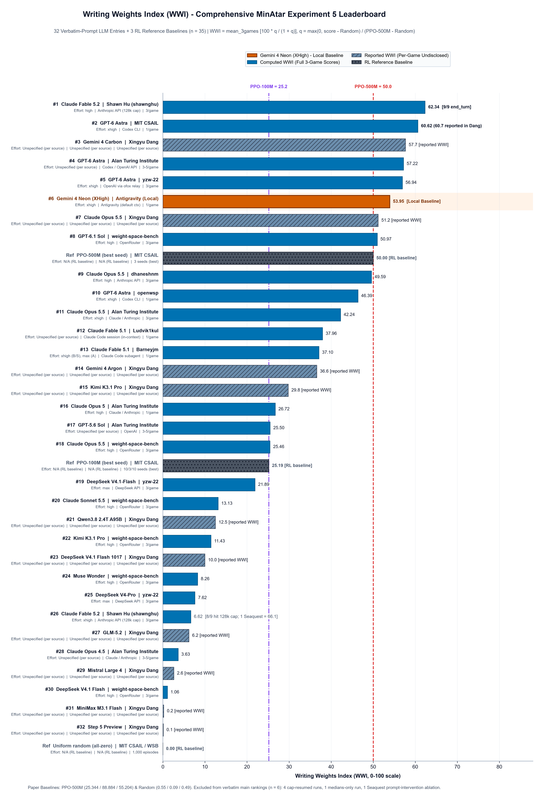
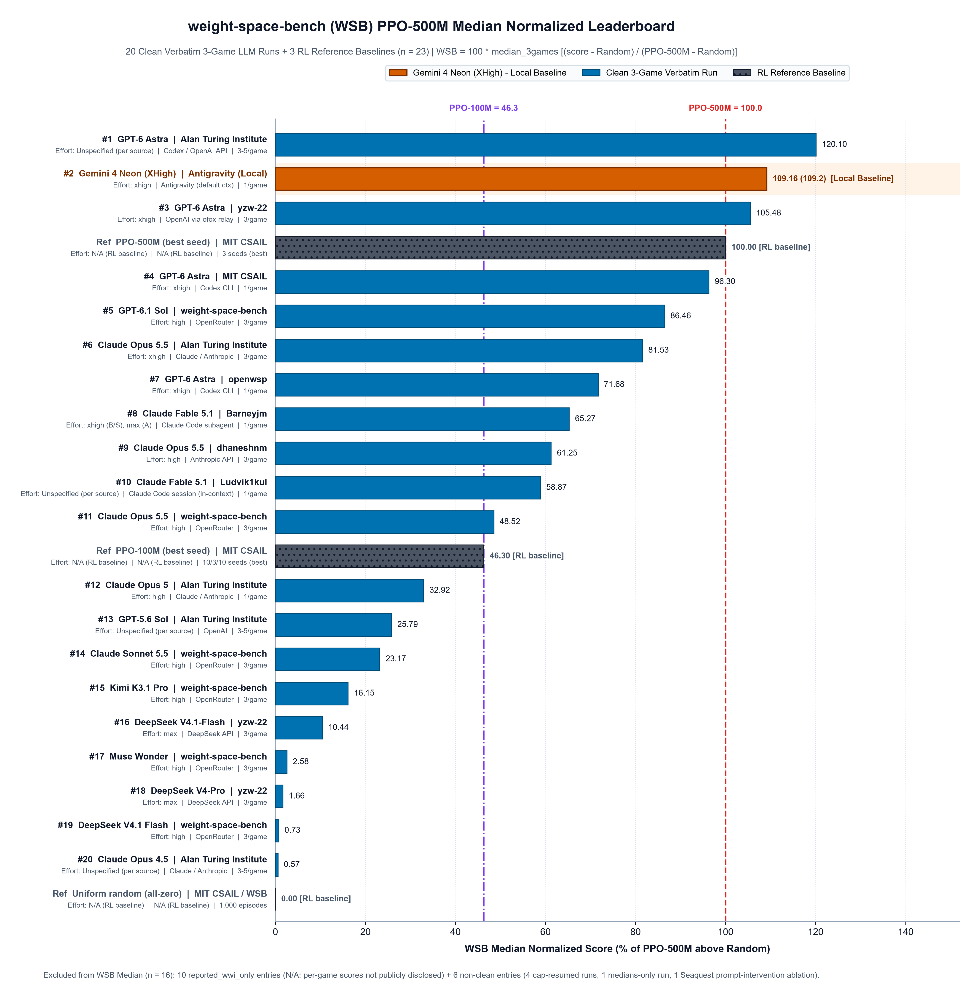
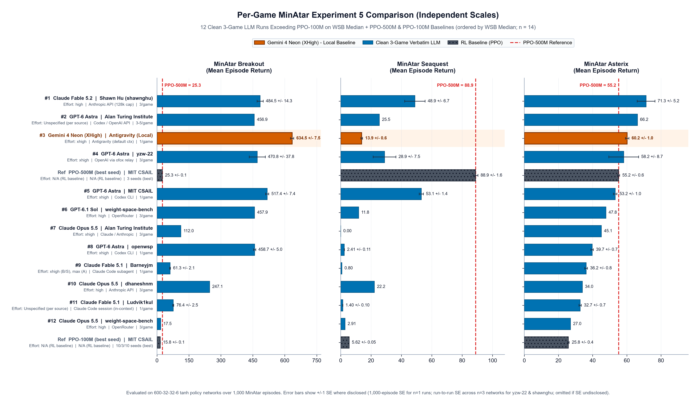

[简体中文 (README.zh-CN.md)](README.zh-CN.md) | [English (README.md)](README.md) | [Seaquest 提示词干预消融实验 (中文)](docs/prompt-intervention-ablation.zh-CN.md) | [Seaquest Prompt-Intervention Ablation (EN)](docs/prompt-intervention-ablation.md) | [LICENSE](LICENSE) | [THIRD_PARTY.md](THIRD_PARTY.md)

# 综合权重空间编程排行榜（MinAtar Experiment 5）

[%20%2B%20CC%20BY%204.0%20(docs%2Fdata)-blue.svg)](LICENSE)
[-orange.svg)](#4-核心亮点与方法论)
[](scripts/privacy_scan.py)

本仓库全面汇集了全网 `22` 个公开来源共 **`41`** 条 **权重空间编程（Weight-Space Programming, WSP）MinAtar Experiment 5** 评测记录（涵盖 MIT CSAIL、Shawn Hu 的 `Claude Fable 5.2`、Xingyu Dang、`eomcaleb/weight-space-bench`、Alan Turing Institute `arXiv:2611.21449` 及社区复现）与本地实测的 **Gemini 4 Neon（`xhigh`）** 产物，并按 **Writing Weights Index（WWI）** 与 **`weight-space-bench` PPO-500M 中位数**双公式确定性重算。*（另见独立专题页：[Seaquest 单句提示词干预消融实验](docs/prompt-intervention-ablation.zh-CN.md)，仅加一句话即令 Seaquest 暴涨 `+29.66%`、非零权重翻倍 `550 -> 1,172`。）*

---

## 1. Writing Weights Index (WWI) 综合排行榜



*表 1 与 [`data/leaderboard_wwi.csv`](data/leaderboard_wwi.csv) 完全一致（`include_in_main_wwi = True`：**32** 条原始提示词模型记录 + **3** 条 RL 参考基线 = **35** 行主榜）。提示词干预消融（`55.0657`）及其他协议偏离条目严格隔离于[第 5 节](#5-协议隔离与不可直接对比结果)；公式定义与基线说明见[第 4 节](#4-核心亮点与方法论)。*

| 排名 | 模型 | 来源 | WWI | 分数类型 | Breakout | Seaquest | Asterix | 思考强度 | 平台 / API | 尝试次数 |
|---:|---|---|---:|---|---:|---:|---:|---|---|---|
| 1 | **Claude Fable 5.2** | **Shawn Hu (shawnghu)** | **62.3367** | computed_wwi | **484.5283** | **48.8923** | **71.3117** | **high** | **Anthropic API (128k cap)** | **3/game** |
| 2 | GPT-6 Astra | MIT CSAIL | 60.6221 *(60.7 reported)* | computed_wwi | 517.4110 | 53.1100 | 53.1780 | xhigh | Codex CLI | 1/game |
| 3 | Gemini 4 Carbon | Xingyu Dang | 57.7000 | reported WWI | N/A (per-game scores not publicly disclosed) | N/A (per-game scores not publicly disclosed) | N/A (per-game scores not publicly disclosed) | Unspecified (per source) | Unspecified (per source) | Unspecified (per source) |
| 4 | GPT-6 Astra | Alan Turing Institute | 57.2207 | computed_wwi | 456.9000 | 25.5000 | 66.2000 | Unspecified (per source) | Codex / OpenAI API | 3-5/game |
| 5 | GPT-6 Astra | yzw-22 | 56.9405 | computed_wwi | 470.8000 | 28.9000 | 58.2000 | xhigh | OpenAI via ofox relay | 3/game |
| 6 | **Gemini 4 Neon (XHigh)** | **Antigravity (Local)** | **53.9532** | computed_wwi | **634.4770** | **13.8690** | **60.2170** | **xhigh** | **Antigravity (default ctx)** | **1/game** |
| 7 | Claude Opus 5.5 | Xingyu Dang | 51.2000 | reported WWI | N/A (per-game scores not publicly disclosed) | N/A (per-game scores not publicly disclosed) | N/A (per-game scores not publicly disclosed) | Unspecified (per source) | Unspecified (per source) | Unspecified (per source) |
| 8 | GPT-6.1 Sol | weight-space-bench | 50.9667 | computed_wwi | 457.8930 | 11.8240 | 47.7980 | high | OpenRouter | 3/game |
| Baseline | PPO-500M (best seed) | MIT CSAIL | 50.0000 *(50.0 reported)* | computed_wwi | 25.3440 | 88.8840 | 55.2040 | N/A (RL baseline) | N/A (RL baseline) | 3 seeds (best) |
| 9 | Claude Opus 5.5 | dhaneshnm | 49.5935 | computed_wwi | 247.0667 | 22.2000 | 34.0000 | high | Anthropic API | 3/game |
| 10 | GPT-6 Astra | openwsp | 46.3872 | computed_wwi | 458.7300 | 2.4070 | 39.7090 | xhigh | Codex CLI | 1/game |
| 11 | Claude Opus 5.5 | Alan Turing Institute | 42.2385 | computed_wwi | 112.0000 | 0.0000 | 45.1000 | xhigh | Claude / Anthropic | 3/game |
| 12 | Claude Fable 5.1 | Ludvik1kul | 37.9580 | computed_wwi | 76.4000 | 1.4000 | 32.7000 | Unspecified (per source) | Claude Code session (in-context) | 1/game |
| 13 | Claude Fable 5.1 | Barneyjm | 37.1004 | computed_wwi | 61.3000 | 0.8000 | 36.2000 | xhigh (B/S), max (A) | Claude Code subagent | 1/game |
| 14 | Gemini 4 Argon | Xingyu Dang | 36.6000 | reported WWI | N/A (per-game scores not publicly disclosed) | N/A (per-game scores not publicly disclosed) | N/A (per-game scores not publicly disclosed) | Unspecified (per source) | Unspecified (per source) | Unspecified (per source) |
| 15 | Kimi K3.1 Pro | Xingyu Dang | 29.8000 | reported WWI | N/A (per-game scores not publicly disclosed) | N/A (per-game scores not publicly disclosed) | N/A (per-game scores not publicly disclosed) | Unspecified (per source) | Unspecified (per source) | Unspecified (per source) |
| 16 | Claude Opus 5 | Alan Turing Institute | 26.7168 | computed_wwi | 30.9000 | 0.4000 | 18.5000 | high | Claude / Anthropic | 1/game |
| 17 | GPT-5.6 Sol | Alan Turing Institute | 25.4983 | computed_wwi | 31.1000 | 0.8000 | 14.6000 | Unspecified (per source) | OpenAI | 3-5/game |
| 18 | Claude Opus 5.5 | weight-space-bench | 25.4649 | computed_wwi | 17.5320 | 2.9070 | 27.0380 | high | OpenRouter | 3/game |
| Baseline | PPO-100M (best seed) | MIT CSAIL | 25.1852 *(25.2 reported)* | computed_wwi | 15.7790 | 5.6170 | 25.8200 | N/A (RL baseline) | N/A (RL baseline) | 10/3/10 seeds (best) |
| 19 | DeepSeek V4.1-Flash | yzw-22 | 21.8937 | computed_wwi | 32.1000 | 0.3000 | 6.2000 | max | DeepSeek API | 3/game |
| 20 | Claude Sonnet 5.5 | weight-space-bench | 13.1274 | computed_wwi | 6.5650 | 1.0300 | 13.1670 | high | OpenRouter | 3/game |
| 21 | Qwen3.8 2.4T A95B | Xingyu Dang | 12.5000 | reported WWI | N/A (per-game scores not publicly disclosed) | N/A (per-game scores not publicly disclosed) | N/A (per-game scores not publicly disclosed) | Unspecified (per source) | Unspecified (per source) | Unspecified (per source) |
| 22 | Kimi K3.1 Pro | weight-space-bench | 11.4312 | computed_wwi | 6.8100 | 0.2920 | 9.3290 | high | OpenRouter | 3/game |
| 23 | DeepSeek V4.1 Flash 1017 | Xingyu Dang | 10.0000 | reported WWI | N/A (per-game scores not publicly disclosed) | N/A (per-game scores not publicly disclosed) | N/A (per-game scores not publicly disclosed) | Unspecified (per source) | Unspecified (per source) | Unspecified (per source) |
| 24 | Muse Wonder | weight-space-bench | 8.2625 | computed_wwi | 7.4040 | 0.6440 | 1.8990 | high | OpenRouter | 3/game |
| 25 | DeepSeek V4-Pro | yzw-22 | 7.6170 | computed_wwi | 7.0000 | 0.6000 | 1.4000 | max | DeepSeek API | 3/game |
| 26 | Claude Fable 5.2 | Shawn Hu (shawnghu) | 6.6223 | computed_wwi | 0.5500 | 22.1040 | 0.4843 | xhigh | Anthropic API (128k cap) | 3/game |
| 27 | GLM-5.2 | Xingyu Dang | 6.2000 | reported WWI | N/A (per-game scores not publicly disclosed) | N/A (per-game scores not publicly disclosed) | N/A (per-game scores not publicly disclosed) | Unspecified (per source) | Unspecified (per source) | Unspecified (per source) |
| 28 | Claude Opus 4.5 | Alan Turing Institute | 3.6281 | computed_wwi | 3.4000 | 0.1000 | 0.8000 | Unspecified (per source) | Claude / Anthropic | 3-5/game |
| 29 | Mistral Large 4 | Xingyu Dang | 2.6000 | reported WWI | N/A (per-game scores not publicly disclosed) | N/A (per-game scores not publicly disclosed) | N/A (per-game scores not publicly disclosed) | Unspecified (per source) | Unspecified (per source) | Unspecified (per source) |
| 30 | DeepSeek V4.1 Flash | weight-space-bench | 1.0636 | computed_wwi | 0.7300 | 0.1730 | 1.8220 | high | OpenRouter | 3/game |
| 31 | MiniMax M3.1 Flash | Xingyu Dang | 0.2000 | reported WWI | N/A (per-game scores not publicly disclosed) | N/A (per-game scores not publicly disclosed) | N/A (per-game scores not publicly disclosed) | Unspecified (per source) | Unspecified (per source) | Unspecified (per source) |
| 32 | Step 5 Preview | Xingyu Dang | 0.1000 | reported WWI | N/A (per-game scores not publicly disclosed) | N/A (per-game scores not publicly disclosed) | N/A (per-game scores not publicly disclosed) | Unspecified (per source) | Unspecified (per source) | Unspecified (per source) |
| Baseline | Uniform random (all-zero) | MIT CSAIL / WSB | 0.0000 *(0.0 reported)* | computed_wwi | 0.5500 | 0.0900 | 0.4900 | N/A (RL baseline) | N/A (RL baseline) | 1,000 episodes |

---

## 2. `weight-space-bench` PPO-500M 中位数归一化排行榜



*表 2 与 [`data/leaderboard_wsb_median.csv`](data/leaderboard_wsb_median.csv) 完全一致（`include_in_main_wsb = True`：**22** 个干净原始提示词三游戏运行 + **3** 条 RL 参考基线 = **25** 行主榜）。`WSB Pub` 列记录 `weight-space-bench/leaderboard/leaderboard.csv` 原表发布数值。*

| 排名 | 模型 | 来源 | WSB 中位数 | WSB Pub | Breakout (% PPO-500M) | Seaquest (% PPO-500M) | Asterix (% PPO-500M) | 思考强度 | 平台 / API | 尝试次数 |
|---:|---|---|---:|---:|---:|---:|---:|---|---|---|
| 1 | **Claude Fable 5.2** | **Shawn Hu (shawnghu)** | **129.4398** | — | **484.5283 (1952.00%)** | **48.8923 (54.96%)** | **71.3117 (129.44%)** | **high** | **Anthropic API (128k cap)** | **3/game** |
| 2 | GPT-6 Astra | Alan Turing Institute | 120.0972 | — | 456.9000 (1840.57%) | 25.5000 (28.62%) | 66.2000 (120.10%) | Unspecified (per source) | Codex / OpenAI API | 3-5/game |
| 3 | **Gemini 4 Neon (XHigh)** | **Antigravity (Local)** | **109.1622** | — | **634.4770 (2556.78%)** | **13.8690 (15.52%)** | **60.2170 (109.16%)** | **xhigh** | **Antigravity (default ctx)** | **1/game** |
| 4 | GPT-6 Astra | yzw-22 | 105.4757 | — | 470.8000 (1896.63%) | 28.9000 (32.45%) | 58.2000 (105.48%) | xhigh | OpenAI via ofox relay | 3/game |
| Baseline | PPO-500M (best seed) | MIT CSAIL | 100.0000 | 100.00 | 25.3440 (100.00%) | 88.8840 (100.00%) | 55.2040 (100.00%) | N/A (RL baseline) | N/A (RL baseline) | 3 seeds (best) |
| 5 | GPT-6 Astra | MIT CSAIL | 96.2971 | 96.30 | 517.4110 (2084.62%) | 53.1100 (59.71%) | 53.1780 (96.30%) | xhigh | Codex CLI | 1/game |
| 6 | GPT-6.1 Sol | weight-space-bench | 86.4642 | 86.46 | 457.8930 (1844.57%) | 11.8240 (13.21%) | 47.7980 (86.46%) | high | OpenRouter | 3/game |
| 7 | Claude Opus 5.5 | Alan Turing Institute | 81.5331 | — | 112.0000 (449.50%) | 0.0000 (-0.10%) | 45.1000 (81.53%) | xhigh | Claude / Anthropic | 3/game |
| 8 | GPT-6 Astra | openwsp | 71.6800 | — | 458.7300 (1847.95%) | 2.4070 (2.61%) | 39.7090 (71.68%) | xhigh | Codex CLI | 1/game |
| 9 | Claude Fable 5.1 | Barneyjm | 65.2667 | — | 61.3000 (245.02%) | 0.8000 (0.80%) | 36.2000 (65.27%) | xhigh (B/S), max (A) | Claude Code subagent | 1/game |
| 10 | Claude Opus 5.5 | dhaneshnm | 61.2458 | — | 247.0667 (994.26%) | 22.2000 (24.90%) | 34.0000 (61.25%) | high | Anthropic API | 3/game |
| 11 | Claude Fable 5.1 | Ludvik1kul | 58.8698 | — | 76.4000 (305.92%) | 1.4000 (1.48%) | 32.7000 (58.87%) | Unspecified (per source) | Claude Code session (in-context) | 1/game |
| 12 | Claude Opus 5.5 | weight-space-bench | 48.5214 | 48.52 | 17.5320 (68.49%) | 2.9070 (3.17%) | 27.0380 (48.52%) | high | OpenRouter | 3/game |
| Baseline | PPO-100M (best seed) | MIT CSAIL | 46.2953 | 46.30 | 15.7790 (61.42%) | 5.6170 (6.22%) | 25.8200 (46.30%) | N/A (RL baseline) | N/A (RL baseline) | 10/3/10 seeds (best) |
| 13 | Claude Opus 5 | Alan Turing Institute | 32.9166 | — | 30.9000 (122.41%) | 0.4000 (0.35%) | 18.5000 (32.92%) | high | Claude / Anthropic | 1/game |
| 14 | GPT-5.6 Sol | Alan Turing Institute | 25.7886 | — | 31.1000 (123.22%) | 0.8000 (0.80%) | 14.6000 (25.79%) | Unspecified (per source) | OpenAI | 3-5/game |
| 15 | Claude Sonnet 5.5 | weight-space-bench | 23.1696 | 23.17 | 6.5650 (24.26%) | 1.0300 (1.06%) | 13.1670 (23.17%) | high | OpenRouter | 3/game |
| 16 | Kimi K3.1 Pro | weight-space-bench | 16.1549 | 16.15 | 6.8100 (25.25%) | 0.2920 (0.23%) | 9.3290 (16.15%) | high | OpenRouter | 3/game |
| 17 | DeepSeek V4.1-Flash | yzw-22 | 10.4361 | — | 32.1000 (127.25%) | 0.3000 (0.24%) | 6.2000 (10.44%) | max | DeepSeek API | 3/game |
| 18 | Muse Wonder | weight-space-bench | 2.5752 | 2.57 | 7.4040 (27.64%) | 0.6440 (0.62%) | 1.8990 (2.58%) | high | OpenRouter | 3/game |
| 19 | DeepSeek V4-Pro | yzw-22 | 1.6632 | — | 7.0000 (26.01%) | 0.6000 (0.57%) | 1.4000 (1.66%) | max | DeepSeek API | 3/game |
| 20 | DeepSeek V4.1 Flash | weight-space-bench | 0.7260 | 0.75 | 0.7300 (0.73%) | 0.1730 (0.09%) | 1.8220 (2.43%) | high | OpenRouter | 3/game |
| 21 | Claude Opus 4.5 | Alan Turing Institute | 0.5666 | — | 3.4000 (11.49%) | 0.1000 (0.01%) | 0.8000 (0.57%) | Unspecified (per source) | Claude / Anthropic | 3-5/game |
| 22 | Claude Fable 5.2 | Shawn Hu (shawnghu) | 0.0000 | — | 0.5500 (0.00%) | 22.1040 (24.79%) | 0.4843 (-0.01%) | xhigh | Anthropic API (128k cap) | 3/game |
| Baseline | Uniform random (all-zero) | MIT CSAIL / WSB | 0.0000 | 0.00 | 0.5500 (0.00%) | 0.0900 (0.00%) | 0.4900 (0.00%) | N/A (RL baseline) | N/A (RL baseline) | 1,000 episodes |

### 第二层信息披露：仅公开 WWI 总分的模型（不计入 WSB 中位数排名）
以下 10 个模型仅出现在 Xingyu Dang 的 WWI 图表中（`reported WWI`），未公开任何单游戏原始回报，因此其 WSB 中位数及三个分游戏字段均严格标记为 `N/A (per-game scores not publicly disclosed)`：

| 模型 | 来源 | 报告 WWI | WSB 中位数 | Breakout / Seaquest / Asterix | 思考强度 / 平台 / 尝试次数 |
|---|---|---:|---|---|---|
| Gemini 4 Carbon | Xingyu Dang | 57.7000 | N/A (per-game scores not publicly disclosed) | N/A (per-game scores not publicly disclosed) | Unspecified (per source) |
| Claude Opus 5.5 | Xingyu Dang | 51.2000 | N/A (per-game scores not publicly disclosed) | N/A (per-game scores not publicly disclosed) | Unspecified (per source) |
| Gemini 4 Argon | Xingyu Dang | 36.6000 | N/A (per-game scores not publicly disclosed) | N/A (per-game scores not publicly disclosed) | Unspecified (per source) |
| Kimi K3.1 Pro | Xingyu Dang | 29.8000 | N/A (per-game scores not publicly disclosed) | N/A (per-game scores not publicly disclosed) | Unspecified (per source) |
| Qwen3.8 2.4T A95B | Xingyu Dang | 12.5000 | N/A (per-game scores not publicly disclosed) | N/A (per-game scores not publicly disclosed) | Unspecified (per source) |
| DeepSeek V4.1 Flash 1017 | Xingyu Dang | 10.0000 | N/A (per-game scores not publicly disclosed) | N/A (per-game scores not publicly disclosed) | Unspecified (per source) |
| GLM-5.2 | Xingyu Dang | 6.2000 | N/A (per-game scores not publicly disclosed) | N/A (per-game scores not publicly disclosed) | Unspecified (per source) |
| Mistral Large 4 | Xingyu Dang | 2.6000 | N/A (per-game scores not publicly disclosed) | N/A (per-game scores not publicly disclosed) | Unspecified (per source) |
| MiniMax M3.1 Flash | Xingyu Dang | 0.2000 | N/A (per-game scores not publicly disclosed) | N/A (per-game scores not publicly disclosed) | Unspecified (per source) |
| Step 5 Preview | Xingyu Dang | 0.1000 | N/A (per-game scores not publicly disclosed) | N/A (per-game scores not publicly disclosed) | Unspecified (per source) |

---

## 3. 分游戏得分对比分析（Breakout / Seaquest / Asterix）



在 WSB 中位数超过 `PPO-100M` 的 **12** 个干净原始提示词 LLM 运行中，三款游戏呈现出高度一致的结构性分化：
- **Breakout（确定性球体运动学）**：前沿模型凭借精确几何查表大幅碾压 `PPO-500M`（`25.344`）。**Gemini 4 Neon（`xhigh`）** 刷新全网原始提示词 Breakout 最高纪录 **`634.477 ± 7.514`**（为 `PPO-500M` 的 `2,556.8%`，单局最高 `827.0`，平均回合长度 `8,235.7` 步），领先于 `GPT-6 Astra`（MIT `517.411`、`yzw-22` `470.800`、`openwsp` `458.730`、Turing `456.900`）、`Claude Fable 5.2`（`high`，`shawnghu` `484.528 ± 14.293`）和 `GPT-6.1 Sol`（WSB `457.893`）。
- **Asterix（中轴线纵向避险）**：共有 4 组干净运行超越 `PPO-500M`（`55.204`）：**`Claude Fable 5.2`（`high`，`shawnghu`）** 以 **`71.312 ± 5.201`**（`PPO-500M` 的 `129.4%`，单次最高 `81.708`）拔得头筹，随后依次是 `GPT-6 Astra`（Turing `66.200`）、**Gemini 4 Neon（`xhigh`）**（**`60.217 ± 1.039`**，单局最高 `333.0`，`109.2%`）和 `GPT-6 Astra`（`yzw-22` `58.200`）。
- **Seaquest（多目标叠加瓶颈）**：所有单轮零样本大模型均值仍低于 `PPO-500M`（`88.884`），原因在于 Seaquest 需同时协调敌方子弹、友方子弹冷却、氧气耗尽、潜水员容量与 `ch5` 叠加仪表盘解码。MIT `GPT-6 Astra` 达到 `53.110`（`59.7%`），**`Claude Fable 5.2`（`high`，`shawnghu`）** 3 次均值达 **`48.892 ± 6.747`**（且 `Fable 5.2 xhigh` 唯一未截断的 `r2` 单次打出全网最高 **`66.132 ± 1.454`**），`yzw-22` 为 `28.900`，Turing 为 `25.500`，`dhaneshnm` Claude Opus 5.5 为 `22.200`，**Gemini 4 Neon（`xhigh`）** 基线为 **`13.869 ± 0.552`**（`15.5%`，高于 `GPT-6.1 Sol` WSB 的 `11.824`）。

---

## 4. 核心亮点与方法论

### 核心亮点
- **双公式统一整合（`41` 条模型记录 + `6` 项不可直接对比套件）**：完整收录 MIT CSAIL（`Takehi et al., Nov 2026`）、Shawn Hu 的 `Claude Fable 5.2` 复现（`shawnghu`，含 `high` 与 `xhigh`）、Xingyu Dang 14 条柱状图（`@xingyudang`）、`eomcaleb/weight-space-bench`、Alan Turing Institute（`arXiv:2611.21449`）、14 个社区 Experiment 5 仓库以及本地 Gemini 4 Neon（`xhigh`）基线运行。
- **双榜新科第一（`Claude Fable 5.2`, `high`）与高思考预算截断悖论**：在 `high` 强度下（`128k` 输出上限，`9/9 end_turn`），`Claude Fable 5.2`（`shawnghu`）以 **WWI `62.3367`** 与 **WSB 中位数 `129.4398`** 登顶双榜第一（Breakout `484.53` / Seaquest `48.89` / Asterix `71.31`）；但调高至 `xhigh` 后在 `8/9` 次运行中因思考耗尽 `128k` 上限而拉低均值至 `6.62` WWI，尽管唯一完整跑完的 `seaquest/r2` 创下 **`66.132`** 单次纪录。
- **Gemini 4 Neon（`xhigh`）基线表现**：在全部 32 个使用原始提示词的条目中位列 **WWI 第 6 名（`53.9532`）**，在 22 个完整披露三游戏分数的干净运行中位列 **WSB 中位数第 3 名（`109.1622`）**，全面超越 `PPO-500M`（`50.0` WWI / `100.0` WSB），并稳居全网原始提示词 **Breakout 最高得分纪录（`634.477 ± 7.514`**, 为 `PPO-500M` 的 `2,556.8%`）。
- **权重电路级机理解析**：通过 `scripts/verify_artifacts.py` 将 `reply.md` -> `edits.json` -> `network.npz` 进行 `0.0` 浮点误差还原验证，剖析 Gemini 4 Neon（`xhigh`）如何在 Breakout 实现 20 状态墙壁反射中点查表、在 Asterix 实现奇偶校验链解码与粘滞动作防过冲保护、以及在 Seaquest 实现双格温度计与氧气条歧义消除。
- **独立 Seaquest 提示词干预消融专题**（[中文页](docs/prompt-intervention-ablation.zh-CN.md) | [English](docs/prompt-intervention-ablation.md)）：在提示词末尾仅追加一句话使 Seaquest 回报提升 **`+29.66%`**（`13.869 ± 0.552 -> 17.982 ± 0.743`，`z = 4.4426`，`p = 8.887e-6`），非零权重翻倍（`550 -> 1,172`）且**没有任何相同坐标共享相同非零值**（余弦相似度 `-0.2059`）；该结果**严格不纳入主排行榜的原始提示词排名**。

### 4.1 MIT CSAIL Experiment 5 评测协议
所有干净主榜条目均遵循统一的 **MIT CSAIL Experiment 5** 零样本权重编写规范（`Takehi et al., Nov 2026`）：
- **网络结构**：`600 -> 32 -> 32 -> 6` 全连接多层感知机（`W1: 600x32`、`b1: 32`、`W2: 32x32`、`b2: 32`、`W3: 32x6`、`b3: 6`，总计 `20,486` 个参数），隐藏层激活函数为 **`tanh`**，输出经 **softmax** 采样 `6` 个离散动作（统一展平 `(10, 10, 6)` -> `600` 维输入）。
- **环境与随机种子**：`MinAtar==1.0.15`（`Breakout`、`Seaquest`、`Asterix`），`sticky_action_prob = 0.1`，`difficulty_ramping = True`，`max_steps = 10000`，在 **`seed = 0..999` 共 `1,000` 个测试回合**上评估。
- **输出形式**：零工具调用、单轮纯文本输出 ```` ```edits ```` 权重赋值代码块，直接作用于全零初始化网络。

### 4.2 官方参考基线（`data/leaderboard_models.json`）

| 参考基线 | Breakout | Seaquest | Asterix | WWI | WSB 中位数 | 来源与定义 |
|---|---:|---:|---:|---:|---:|---|
| **PPO-500M (best seed)** | `25.344` (`± 0.121`) | `88.884` (`± 1.562`) | `55.204` (`± 0.636`) | **`50.0000`** (`50.0`) | **`100.0000`** (`100.00`) | MIT CSAIL（3 个种子中最佳：`s0 / s2 / s1`） |
| **PPO-100M (best seed)** | `15.779` (`± 0.093`) | `5.617` (`± 0.049`) | `25.820` (`± 0.447`) | **`25.1852`** (`25.2`) | **`46.2953`** (`46.30`) | MIT CSAIL（`10/3/10` 个种子中最佳：`s2 / s2 / s6`） |
| **Uniform random (all-zero)** | `0.55` | `0.09` | `0.49` | **`0.0000`** (`0.0`) | **`0.0000`** (`0.00`) | 全零网络对 6 个动作均匀随机采样 |

### 4.3 双基准公式定义

1. **Writing Weights Index (WWI)**（Xingyu Dang，2026 年 11 月 2 日）：
   $$\text{WWI} = \frac{1}{3} \sum_{g \in \{\text{Breakout, Seaquest, Asterix}\}} 100 \cdot \frac{q_g}{1 + q_g}, \qquad q_g = \frac{\max(0,\; \text{score}_g - \text{random}_g)}{\text{PPO500M}_g - \text{random}_g}$$
   - `Uniform random` 对应 $q_g = 0 \implies \text{WWI} = 0.0$；`PPO-500M` 对应 $q_g = 1 \implies \text{WWI} = 50.0$；超出 `PPO-500M` 的单项得分会渐近饱和至 `100.0`，防止单一优势游戏（如 Breakout `634.5`）掩盖 Seaquest 短板。

2. **`weight-space-bench` (WSB) PPO-500M 中位数归一化得分**（`eomcaleb/weight-space-bench`，2026 年 11 月 3 日）：
   $$\text{WSB Median} = 100 \times \operatorname{median}_{g \in \{\text{Breakout, Seaquest, Asterix}\}} \left(\frac{\text{score}_g - \text{random}_g}{\text{PPO500M}_g - \text{random}_g}\right)$$
   - `Uniform random` = `0.00`，`PPO-100M` = `46.30`（`46.2953`），`PPO-500M` = `100.00`。该指标取三项游戏相对 `PPO-500M` 比例的中位数，对多数前沿模型而言即对应中间项 Asterix 的表现。

### 4.4 严格数据分层规则
1. **第一层（`full_3game_clean`）**：严格使用原始提示词、单轮、600-32-32-6 结构且公开全部 3 个游戏均值的结果，直接计算 WWI 与 WSB 中位数。
2. **第二层（`reported_wwi_only`）**：来自 Xingyu Dang 图表但未公开各游戏原始得分的条目。保留在 WWI 主榜并明确标注 `reported WWI`，在分游戏列及 WSB 中位数披露表中严格标记为 `N/A (per-game scores not publicly disclosed)`。
3. **协议字段披露**：来源未公开思考强度、API/平台渠道或尝试次数的条目，均如实标为 `Unspecified (per source)`，绝不臆测补全。
4. **协议隔离**：提示词干预消融（`ablation_prompted`）、截断后自动续写（`resumed_after_cap`）、仅报告中位数的复现（`medians_only`）以及结构或协议不兼容项目（`partial_and_non_comparable`）**全部从主榜排除**，于 [第 5 节](#5-协议隔离与不可直接对比结果) 单独呈现。

---

## 5. 协议隔离与不可直接对比结果

### 5.1 协议偏离与提示词干预消融隔离表（`6` 条记录从主榜排除）

| 模型 | 来源 | 分层 / 标记 | WWI | WSB 中位数 | Breakout | Seaquest | Asterix | 思考强度 / 平台 / 尝试次数 | 从主榜排除原因 |
|---|---|---|---:|---:|---:|---:|---:|---|---|
| GPT-6 Astra (Medians Only) | ZhangYiqun018 | `medians_only` | 58.5488 | 113.3768 | 487.7720 | 33.5250 | 62.5230 | xhigh / OpenAI-compatible API / 10-11/game | 报告多次运行的**中位数**（`n=11` B IQR `469.4..526.1`；`n=10` S IQR `18.0..37.7`，A IQR `48.8..65.8`）而非均值。 |
| **Gemini 4 Neon (XHigh, Seaquest Prompted)** | **Antigravity (Local)** | **`ablation_prompted`** | **55.0657** | **109.1622** | **634.4770** | **17.9820** | **60.2170** | **xhigh / Antigravity (default ctx) / 1/game** | **Seaquest 追加单句提示词干预实验（`13.87 -> 17.98`，`+29.66%`）；详见独立消融页：[中文](docs/prompt-intervention-ablation.zh-CN.md) \| [EN](docs/prompt-intervention-ablation.md)。** |
| Claude Opus 5.5 (Resumed) | MatinKhajavi | `resumed_after_cap` | 50.7958 | 85.0111 | 483.5860 | 11.4250 | 47.0030 | xhigh / Claude Code CLI 2.1.317 / 1/game | Breakout（`cut=0.509`）与 Seaquest（`cut=0.119`）触发 `128k` 上限后断点续写。 |
| Claude Opus 5.5 (Resumed) | Rekigan | `resumed_after_cap` | 50.2584 | 82.8734 | 91.6000 | 32.7000 | 45.8333 | Unspecified (per source) / Claude Code subagent / 1/1/3 | Breakout、Seaquest 及 2/3 Asterix 运行在输出上限后触发自动续写。 |
| Claude Fable 5.1 (Resumed) | MatinKhajavi | `resumed_after_cap` | 47.9966 | 89.3811 | 38.4450 | 50.7870 | 49.3940 | xhigh / Claude Code CLI 2.1.317 / 1/game | Breakout（`cut=0.509`）与 Seaquest（`cut=0.119`）触发 `128k` 上限后断点续写。 |
| Claude Opus 5.5 (Resumed) | Sir-Olexander | `resumed_after_cap` | 44.9989 | 130.7106 | 57.3580 | 8.5780 | 72.0070 | xhigh / Claude Code CLI 2.1.318 / 1/game | Breakout 与 Seaquest 在达到 `128k` 上限后触发自动续写。 |

### 5.2 部分结果与协议不兼容套件（`partial_and_non_comparable`）

1. **WeightBench（`Aayush-Marasini/WeightBench`，`arXiv:2611.18553`，2026 年 11 月 13 日）**：其 Track TR-04 WRITE（`TR04-GAME-001..003`）与 Experiment 5 存在本质协议差异：采用 ReLU（非 `tanh`）、贪心 `argmax`（非 softmax）、`100` 回合 / `1,000` 最大步数、channel-first 输入、80–200 轮带 Python/NumPy 的智能体 CLI 沙盒，并仅公布相对非 Exp 5 天花板 `S_max` 的归一化分数 `S_WB` 而未公开原始 `S_edit` 回报（`claude-opus-5-5`：`1.0 / 1.0 / 1.0`；`openai/gpt-6.1-sol`：`1.0 / 0.4046 / 0.9165`；`claude-sonnet-5-5`：`0.486 / 0.0797-0.5666 / 0.1475-0.4010`；`claude-haiku-5-5`：`0.486 / 0.0111-invalid / 0.1593-0.3733`；`deepseek/deepseek-v4-flash`：`0.0` 隔离无效）。
2. **`Barneyjm/weight-space-minatar` 主表（`256x256`）**：使用更宽的 `256x256` 隐藏层、未合并的 4/10 输入通道并允许 Python/NumPy 工具（`Claude Fable 5.1`：`533.9 / 19.0 / 23.1`；`Claude Opus 5.5`：`7.1 / 13.2 / 13.0`），与纳入表 1–2 的 `matched/` 600-32-32-6 条目不同。
3. **仅含 Breakout 的复现仓库**：缺失 Seaquest 与 Asterix 评测——`niqbal/fable-weight-space-breakout`（`Claude Fable 5.1`：首次 `501.6 ± 5.8`，`2/3` 次触发 `128k` 截断得 `0`，3 次均值 `167.2`）、`jasperzhao05/wsplore`（`GPT-6.1 Sol` 均值 `487.0`，三次为 `480, 603, 378`；`GPT-6 Luna` 均值 `3.0`，三次为 `6, 0, 3`）以及 `mraad/weight-space-programming`（`Claude` 未明型号：`269.4 ± 7.4`）。
4. **Alan Turing Institute（`arXiv:2611.21449`）部分结果与纯区间描述模型**：`GPT-5.2`（Breakout `3.5`，Seaquest/Asterix 因 API 失败缺失）、`Kimi-K3.1-Pro`（`19–68 / 1–2 / 9–42`）、`DeepSeek-V4-Pro`（`2–12 / ~0 / ~0`）以及 `Qwen3.8-27B`（三游戏均值均 `<5`，96 次 Breakout 中最高 `41`）。
5. **`Mid-NIGHTSHARK/weight-space-programming`**：仅含 Breakout、采用非标准 3,000 回合自定义种子调度，且本地记录标签标注为未鉴权（`Gemini Argon 4 Medium` `60.322 ± 1.195`、`Claude Sonnet 5.5` `10.587 ± 0.206`、`GPT-6 Original` `2.516 ± 0.036`、`GPT-6 Luna Extra High` `1.230 ± 0.023`、`DeepSeek Original` `0.493 ± 0.009`）。
6. **`akhaliq/writing-weights-index` OCR 数据卫生警示**：其 `results.jsonl` 为 `0` 字节，且 `app.py` 的 `REFERENCE` 列表存在严重的截图 OCR 识别错误（例如将 `GPT-6 Astra` 错识为 `GPT-5 Astra`、`Gemini 4 Carbon` 错识为 `Gemini 3 Gildron`、`Claude Opus 5.5` 错识为 `Claude Opus 5.9`、`Gemini 4 Argon 36.6` 错识为 `Gemini 3 Alpin 36.0`、`Qwen3.8 2.4T A95B` 错识为 `Qwen3 235B A35B`、`Mistral Large 4 2.6` 错识为 `MiniMax Large 2.6`、`MiniMax M3.1 Flash 0.2` 错识为 `MedsMax MD1 Flash 0.2`、`GLM-5.2` 错识为 `GLM-5.5`、`Step 5 Preview 0.1` 错识为 `Step-3 Preview 0.1`）。本仓库**未**将其作为数据源。

---

## 6. Gemini 4 Neon (XHigh) 权重电路级机理分析

以下全部神经元编号、非零权重计数、偏置范围与编辑语句数均由 `scripts/verify_artifacts.py` 从 `artifacts/gemini-4-neon-xhigh/*/reply.md` 直接重建并与 `network.npz` 比对验证（`max_diff = 0.0`、`errors = []`、`cut_off = false`）。

| 运行 | 平均回报 ± SE | 非零权重总数 (`W1/b1/W2/b2/W3/b3`) | 活跃单元 (`h1`, `h2`) | 语句数 / `entries_written` | 核心算法电路 |
|---|---|---|---|---|---|
| **Breakout** (`attempt_1`) | `634.477 ± 7.514` (`max 827`) | `1,571` (`1436/30/76/12/12/5`) | `32/32`, `12/32` (`h2[12..31]` 为零) | `280/280` / `17,554` | 速度平局决胜器、20 状态墙壁反射中点查表 + 2 格粘滞缓冲、无死循环 `y=8` 砖块前瞻（`-2 mod 20` 相移） |
| **Asterix** (`attempt_1`) | `60.217 ± 1.039` (`max 333`) | `920` (`552/24/274/32/32/6`) | `27/32` (`h1[27..31]` 为零), `32/32` | `296/296` / `1,016` | `x=5` 纵向锁死（`b3=-120`）、解耦奇偶校验链解码、3-bit `P_bit` 行选通、`r±1..4` 粘滞过冲保护与远距金币牵引 |
| **Seaquest 基线** (`attempt_1`) | `13.869 ± 0.552` (`max 128`) | `550` (`290/31/150/31/42/6`) | `32/32`, `32/32` | `222/222` / `552` | `col 2` 朝右锁定、One-Hot `P[0..8]`、`E[3..8]` 右半区瞄准、`V[3..8]` 潜水员拦截（存在满氧歧义） |
| **Seaquest 干预** (`attempt_2_prompted`) | `17.982 ± 0.743` (`max 167`) | `1,172` (`935/29/129/28/45/6`) | `31/32` (`h1[31]` 为零), `32/32` | `269/269` / `1,172` | `x=1` 防线左移、双格 `Y_ge[1..8]` 温度计、`SE[1..8]` + `cooldown`、4 级 `x=4` 子弹预警、`has_diver_certain` 满氧消歧 |

### 6.1 Breakout（`634.48 ± 7.51`，`1,571` 非零权重）
- **精确速度恢复（`h1[0..1]`，各 `190` 个 `W1` 权重，`b1 = 0`）**：结合 `ball`（`ch3`）与 `trail`（`ch4`）并加入边墙/反弹平局决胜偏置（`dx` 含 `+0.5*I(ball_x==0) - 0.5*I(ball_x==9)`，`down` 含 `+0.5*I(ball_y<=4) - 0.5*I(ball_y==8)`），放大 `20` 倍输出严格双值方向符号。
- **20 状态墙壁反射中点查表与 2 格粘滞缓冲（`h1[2..9]`，各 `98–99` 个 `W1` 权重，`b1 = -30`）**：在四个斜向状态 `{UL, UR, DR, DL}` 上精确编码 `40 * (target_d(ball) - pos)`（`max_abs(W1) = 380`）。当 `down = +1, y <= 7` 时，`target` 取两格接球区间 `{ball_x_at_8, new_x_at_9}` 的**中点（`x ± 0.5`）**，留出 2 格容错空间抵御 `sticky_action_prob = 0.1`（使漏球率降低 `10x–100x`）；在 `y = 8` 处设 `target(8, x) = x` 以保持水平方向。
- **`y = 8` 无死循环砖块前瞻（`h1[10..27]`、`h1[28..31]`、`h2[8..11]`）**：`ov_DR[0..8]` 与 `ov_DL[1..9]`（`b1 = -210`）扫描第 `1..3` 行砖块 `ch2`，按 `+10*I(ball==(8,x)) - 8*B(s_same) + 1*B(s_rev \ s_same)` 放大 `×20`，仅当球位于 `(8, x)`、原方向零命中且反向至少命中 `1` 块砖时激活为 `+1`。经 `ge_m1..ge_p2`（`h1[28..31]`）与 `h2[8..11]`（`b2 = +40`）门控后在触板前瞬间反向击球，在空跑趟中沿 20 状态墙壁反射周期（`0..9, 9..0`）强制产生 `-2 mod 20` 相移，彻底杜绝无限死循环。
- **精简决策输出（`h2[0..7]` 与 `W3/b3`）**：`h2[0..7]` 用 3 输入与门（`b2 = -20`）组合 `dx`、`down` 与 `want_{R,L}_d`，`h2[12..31]` 全为零。`b3[1] = b3[3] = 60` 抵消第二层非激活基线和 `-80` 至 `-20`，触发时翻转为 `+20`。（`entries_written = 17,554` 源自对 `W1[:, 2..9]` 与 `W1[:, 10..27]` 执行整列 `*= 40` / `*= 20` 原地缩放。）

### 6.2 Asterix（`60.22 ± 1.04`，`920` 非零权重）
- **中轴线纵向锁死（`x = 5`）**：`b3 = [560, -120, 499, -120, 499, -120]` 将 `left`、`right`、`fire` 永久封死在 `-120`，专注在第 5 列上下游走（消除边墙刷新秒杀并保持 100% 水平扫过覆盖）。
- **解耦奇偶校验链解码（`h1[0..23]`）**：利用 Asterix 每行至多 1 个实体的不变式，`h1[0..7]` 检测 `E_lethal(1..8)`（每行 `4` 个 `W1` 权重），`h1[8..15]`（`E_soon(1..8)`，每行 `16` 权重）与 `h1[16..23]`（`G(1..8)`，每行 `19` 权重）利用 `ch1`/`ch2` 上交替奇偶校验链权重以及严格非正的 `trail`（`ch4 <= 0`）抵消项直接判断来袭与远离方向，给出精确分级距离（`E_soon`：`d = 2 -> 1.0, d = 3 -> 0.5, d = 4 -> 0.15`；金币 `G`：`d = 0..5 -> 1.00..0.35`）。
- **3-Bit 行选通（`P_bit0..2`，`h1[24..26]`）与粘滞过冲前瞻（`h2[0..31]`）**：3 位二进制行编码（`±10` 覆盖 `ch0` 第 `1..8` 行）门控 `U_stay(1..8)`（`h2[0..7]`，第 `2..7` 行含 `+0.056` 中区静止偏好）、`U_up(2..8)`（`h2[8..14]`）与 `U_down(1..7)`（`h2[15..21]`），显式惩罚目标行 `r±1`、1 步过冲 `r±2`、2 步过冲 `r±3` 与 3 步过冲 `r±4`。`h2[22..31]`（`F_up(3..7)`、`F_down(2..6)`）以较小的安全门控输出权重 `W3 = 3.8`（对比局部安全权重 `80`）提供远距金币牵引，仅在 `r±1` 与 `r±2` 完全安全时输出 `+7.6` 打破静止偏好。

### 6.3 Seaquest 电路重构摘要（`550 -> 1,172` 非零权重）
追加单句提示词后，Gemini 4 Neon（`xhigh`）从零构建了一套完全不同的 Seaquest 电路（`13.87 -> 17.98`，`+29.66%`；完整解析见 [Seaquest 消融专题页](docs/prompt-intervention-ablation.zh-CN.md)）：
- **防线左移（`col 2 -> x = 1`）**：消除左侧刷新子弹威胁并将右侧射击射程倍增至 `cols 2..9`，同步反转 `align`（`h1[0]`）输出极性（`W3[0, 1] = +200, W3[0, 3] = -200`）。
- **One-Hot `P[0..8]`（`9` 权重）-> 双格温度计 `Y_ge[1..8]`（`360` 个 `W1` 权重）**：利用潜艇 2 格宽度（`2 * 6 - 6 = +6`）实现第二层精确线性行选择（`b2` 跨度 `[-34.78, +0.3]`）。
- **`SE[1..8]`（`192` 权重）+ `cooldown`（`h1[27]`，`32` 权重）**：将 5 步射击冷却窗口直接转化为纵向机动（平均回合步数 `450.4 -> 368.5`）。
- **4 级子弹预警（`D[1..8]`，新增 `x = 4` 提前探测）**：直接驱动 `cur_good`/`up_state`/`down_state`（`h2[1..23]`）与 `danger_repel`（`h2[31]`），并与由 `Y_ge[1..8]`/`SE[1..8]` 驱动的 `enemy_seek`（`h2[30]`，`b2 = +0.3`）协同提升走位效率。
- **`has_diver_certain`（`h1[25]`）+ `diver_need`（`h1[30]`）+ 双格 `diver_dir`（`h1[28]`）**：彻底修复基线 `V[3..8]` 在高氧气量（`oxygen >= 180`）下误抑潜水员救援的 `ch5` 叠加歧义。

---

## 7. 统计分析、局限性与效度威胁

### 7.1 回合级双样本 z 检验 vs `n = 1` 生成样本局限
对比 Seaquest 基线组（`13.869 ± 0.5519`，`N = 1,000` 回合）与提示词干预组（`17.982 ± 0.7433`，`N = 1,000` 回合）：
$$z = \frac{17.982 - 13.869}{\sqrt{0.551899^2 + 0.743318^2}} = 4.4426, \qquad p_{\text{two-sided}} = 8.887 \times 10^{-6}$$
尽管在 `1,000` 个配对 `MinAtar` 评估种子（`0..999`）上具有高度统计显著性，但**每个实验条件仅包含 `n = 1` 个大模型生成的权重网络样本**。回合级检验仅能证明该干预*网络*显著优于该基线*网络*，尚不能反映大模型多次独立生成的采样方差；验证提示词干预的稳定分布级增益仍需每个条件至少 **`n >= 3` 次独立网络生成复现**（参考 `GPT-6 Astra` 在各外部 `1/game` 与 `3–5/game` 复现中 WWI 跨度为 `46.39–60.62`）。

### 7.2 Antigravity 默认系统上下文 vs 原始 API 提示
本地 Gemini 4 Neon（`xhigh`）运行均在**全新的 Antigravity 主聊天会话**（每次运行独立新会话）中完成，且**零自定义规则覆盖**（无自定义 `GEMINI.md`、`AGENTS.md`、memories、skills 或 hooks），`tool_calls = 0`，严格单轮纯文本输出。然而，与原始 API / 中立 Codex CLI 框架（`MIT CSAIL`、`weight-space-bench`、`yzw-22`、`dhaneshnm`、`openwsp` 仅注入单行 `"Answer the user's request."` 且 `tool_free = true`、零工具声明）不同，Antigravity 环境会在系统上下文中注入**默认 Antigravity 系统提示词与 2 个惰性 MCP 工具存根（`agentdock`、`blender`）**。即便工具调用次数严格为 `0`，系统框架与上下文占用仍存在差异，因此本地运行全部明确标注为 **`Antigravity (default ctx)`**。

### 7.3 输出 Token 截断上限（`64k` / `128k`）与断点续写偏差
超长权重生成极易在输出 ```` ```edits ```` 块前触及 API 上限：
- **`weight-space-bench`（OpenRouter，`64k` 上限）**：`Claude Opus 5.5`（`high`）在 `2/9` 次尝试中触及 `64k` 上限并记 `0.0` 分，使其 WSB 中位数降至 `48.52`（`WWI = 25.46`）。
- **Alan Turing Institute（`arXiv:2611.21449`）**：`Claude Opus 5.5`（`xhigh`）在 `2/3` Breakout 与 `3/3` Seaquest 中触发上限（Seaquest `0.0`，`WWI = 42.24`）；`Claude Opus 5` 在 `xhigh` 下有 `10/12` 次截断（论文只得改报 `high` 强度）。
- **Shawn Hu（`shawnghu`，Anthropic API，`128k` 上限）—— `high` vs `xhigh` 思考预算悖论**：`Claude Fable 5.2` 在 `high` 强度下 **`9/9`** 全部正常结束（`end_turn`，思考 token 约 `53k–114k`），一举拿下**双榜第一**（WWI `62.34` / WSB `129.44`）；但在同一 `128k` 上限下调高至 `xhigh` 后，有 **`8/9`** 次尝试在思考阶段耗尽 `128,000` token（7 次未输出任何权重直接记随机基线，`asterix/r2` 截断得 `0.473`），导致 3 次均值骤降至 `6.62` WWI（`0.00` WSB）——尽管唯一完整跑完的 `seaquest/r2`（`124,576` tokens）创下了全网原始提示词单次 Seaquest 最高纪录 **`66.132 ± 1.454`**。
- **社区上限与续写偏差**：`Barneyjm`（`max` 在 B/S 触及 `64k` 后改用 `xhigh`）、`niqbal`（`2/3` Breakout 触及 `128k` 记 `0`）与 `dhaneshnm`（早期 1 次 `64k` Seaquest 截断被剔除并提额至 `128k`）均印证了同一瓶颈；而依赖 `Claude Code` 自动断点续写的运行（`MatinKhajavi`、`Sir-Olexander`、`Rekigan`）挽回了单轮 API 本应记 `0` 的情况，因此全部隔离于[第 5.1 节](#51-协议偏离与提示词干预消融隔离表6-条记录从主榜排除)。

### 7.4 Random 基线小数精度差异（`GPT-6 Astra`：`60.62` vs `60.7`）
采用 MIT CSAIL 精确基线（`PPO-500M = 25.344 / 88.884 / 55.204`、`Random = 0.55 / 0.09 / 0.49`）重算，`GPT-6 Astra (MIT)` 的 WWI 为 **`60.6221`**（保留 1 位小数为 `60.6`），而 Xingyu Dang 11 月 2 日图表显示 **`60.7`**。`scripts/recompute_leaderboards.py` 敏感性检验表明该差值**并非**由 `Random` 舍入导致：
- `random_paper`（`0.55 / 0.09 / 0.49`）-> `GPT-6 Astra WWI = 60.6221`，**`PPO-100M WWI = 25.1852`**（`25.2`，与 Dang 图表完全吻合）。
- `random_zero`（`0.0 / 0.0 / 0.0`）-> `GPT-6 Astra WWI = 60.5996`，`PPO-100M WWI = 25.3937`（`25.4`，与 Dang 图表 `25.2` 不符）。
- `random_win_local_seed0`（`0.539 / 0.086 / 0.487`）-> `60.6218`；`random_wsb_implied`（`0.545 / 0.093 / 0.492`）-> `60.6217`。

在所有 `Random` 基准下 `GPT-6 Astra` 均处于 `[60.60, 60.62]`（`60.6`），因此 Dang 图表中的 `60.7` 应源自其本人对 1,000 回合的独立重跑或 11 月 2 日标准化前的基线口径。同理，`random_wsb_implied`（`0.545 / 0.093 / 0.492`）可逐项精确还原 `weight-space-bench/leaderboard/leaderboard.csv` 的全部 6 个已发布数值（例如 `Muse Wonder` `2.57` 对 `2.58`、`DeepSeek V4.1 Flash` `0.75` 对 `0.73`）。

---

## 8. 可复现性与仓库结构

```text
comprehensive-weight-space-programming-leaderboard/
├── README.md                                  # 英文主论文风格文档
├── README.zh-CN.md                            # 全对等简体中文文档
├── LICENSE                                    # 双重开源协议（脚本 MIT + 文档/数据/产物 CC BY 4.0）
├── THIRD_PARTY.md                             # 22 项完整上游声明与 GPL-3.0 外部依赖说明
├── requirements.txt                           # 纯 CPU 依赖（MinAtar==1.0.15 为外部 GPL-3.0 依赖）
├── .gitignore
├── docs/
│   ├── prompt-intervention-ablation.md        # Seaquest 提示词干预消融独立页（英文）
│   └── prompt-intervention-ablation.zh-CN.md  # Seaquest 提示词干预消融独立页（简体中文）
├── data/
│   ├── leaderboard_models.json                # 主结构化数据集（41 条模型 + 6 项不可直接对比套件）
│   ├── leaderboard_wwi.csv                    # 重算 WWI 主排行榜（35 行；6 条隔离条目保留于 JSON 与第 5.1 节）
│   ├── leaderboard_wsb_median.csv             # 重算 WSB 中位数主排行榜（25 行；16 条隔离/未披露条目保留于 JSON）
│   └── seaquest_ablation.json                 # Seaquest 基线与干预消融精确对比数据
├── scripts/
│   ├── wsp_eval.py                            # 编辑解析器、WWI 与 WSB 中位数公式、MinAtar 评测引擎
│   ├── recompute_leaderboards.py              # 重算 CSV 排行榜并执行 Random 基线敏感性分析
│   ├── verify_artifacts.py                    # 核验 reply.md -> network.npz（0.0 误差）、z 检验与 MinAtar 复现
│   ├── generate_charts.py                     # 程序化生成 charts/chart1..4.png（300 DPI）
│   └── privacy_scan.py                        # 扫描全仓库路径、凭据与私有会话 UUID
├── charts/
│   ├── chart1_wwi_leaderboard.png
│   ├── chart2_wsb_median_leaderboard.png
│   ├── chart3_per_game_comparison.png
│   └── chart4（消融对比图，仅嵌入 docs/ 消融专题页）
└── artifacts/
    └── gemini-4-neon-xhigh/
        ├── summary.json
        ├── breakout/attempt_1/{edits.json,network.npz,reply.md,score.json}
        ├── asterix/attempt_1/{edits.json,network.npz,reply.md,score.json}
        └── seaquest/
            ├── attempt_1/{edits.json,network.npz,reply.md,score.json}
            └── attempt_2_prompted/{edits.json,network.npz,reply.md,score.json}
```

### 复现与校验命令

```bash
pip install -r requirements.txt
python scripts/recompute_leaderboards.py
python scripts/verify_artifacts.py --workers 15      # 或加 --skip-sim 快速校验编辑与网络一致性
python scripts/generate_charts.py                   # 重新生成 300 DPI 的 charts/chart1..4.png
python scripts/privacy_scan.py                      # 确认全仓库 0 隐私与凭据泄露
```

> **关于 `--workers 15` 的说明**：由于 `MinAtar==1.0.15` 中 `Environment.last_action` 会在同一工作进程分片内的回合间保持状态，指定 `--workers 15` 可在任意 CPU 核心数主机上以 `< 1e-6`（`diff = 0.00e+00`）精确复现 `score.json`；默认 `--workers 0`（`cpu_count - 1`）在进程数非 `15` 时采用 `0.5` 回报容差。

---

## 9. 关于作者

> 作者正在上中学，致力于权重空间编程，希望权重空间编程早日惠及人类

---

## 10. 引用

如果您在研究或工程中使用了本仓库整合的数据集、双公式排行榜分析或 Gemini 4 Neon（`xhigh`）实验产物，请同时引用本仓库与以下奠基性工作：

```bibtex
@misc{opopile2026comprehensivewsp,
  author       = {opopile},
  title        = {Comprehensive Weight-Space Programming Leaderboard: MinAtar Experiment 5 Dual-Formula Consolidation, Gemini 4 Neon (XHigh) Baseline, and Prompt-Intervention Ablation},
  year         = {2026},
  month        = nov,
  howpublished = {\url{https://github.com/opopile/comprehensive-weight-space-programming-leaderboard}}
}

@misc{takehi2026sparks,
  author       = {Takehi, Rikiya and Teoh, Jayden and Zhang, Alex and Khattab, Omar},
  title        = {Sparks of Weight-Space Programming: LLMs can natively read \& write neural network weights},
  year         = {2026},
  month        = nov,
  howpublished = {MIT CSAIL Blog, \url{https://rikiyat.github.io/blog/weight-space-programming/}},
  note         = {Logs released at \url{https://github.com/RikiyaT/lm_understand-logs}}
}

@article{goworek2026replicating,
  author  = {Goworek, Roksana and Hickey, Alexander and Nanni, Federico and O'Reilly, Martin},
  title   = {Replicating and Extending Weight-Space Programming: Frontier LLMs Compile Programs into Weights and Read Input Layers},
  journal = {arXiv preprint arXiv:2611.21449},
  year    = {2026},
  month   = nov,
  url     = {https://arxiv.org/abs/2611.21449}
}

@article{marasini2026weightbench,
  author  = {Marasini, Aayush and Khadka, Barsat and Rahimi, Nick},
  title   = {WeightBench: Evaluating Language Models as Weight-Space Programmers},
  journal = {arXiv preprint arXiv:2611.18553},
  year    = {2026},
  month   = nov,
  doi     = {10.48550/arXiv.2611.18553},
  url     = {https://arxiv.org/abs/2611.18553}
}

@misc{dang2026wwi,
  author       = {Dang, Xingyu},
  title        = {Writing Weights Index (MinAtar Experiment 5 Comparison)},
  year         = {2026},
  month        = nov,
  howpublished = {X (Twitter), \url{https://x.com/xingyudang/status/2117428789068386630}}
}

@misc{eomcaleb2026wsb,
  author       = {eomcaleb},
  title        = {weight-space-bench: Benchmark for Weight-Space Programming},
  year         = {2026},
  month        = nov,
  howpublished = {\url{https://github.com/eomcaleb/weight-space-bench}}
}

@misc{hu2026fablewsp,
  author       = {Hu, Shawn},
  title        = {Claude Fable 5.2 can do `weight-space-programming' about as well as GPT-6 Astra},
  year         = {2026},
  month        = nov,
  howpublished = {LessWrong \& Hugging Face Dataset, \url{https://huggingface.co/datasets/shawnghu/fable-weight-space-programming}}
}

@article{young2019minatar,
  author  = {Young, Kenny and Tian, Tian},
  title   = {MinAtar: An Atari-Inspired Testbed for Thorough and Reproducible Reinforcement Learning Experiments},
  journal = {arXiv preprint arXiv:1903.03176},
  year    = {2019},
  url     = {https://github.com/kenjyoung/MinAtar}
}
```

---

## 11. 开源协议与第三方声明

- **仓库双重开源协议（[`LICENSE`](LICENSE)）**：
  - 原创核验与绘图脚本（`scripts/*.py`）采用 **MIT License**。
  - 原创中英文文档（`README.md`、`README.zh-CN.md`、`docs/*.md`）、汇总数据集（`data/*`）、生成图表（`charts/*`）以及本地 Gemini 4 Neon（`xhigh`）实验产物（`artifacts/*`）采用 **Creative Commons Attribution 4.0 International（CC BY 4.0）**。
- **第三方作品与未捆绑运行依赖（[`THIRD_PARTY.md`](THIRD_PARTY.md)）**：
  - 上游 MIT CSAIL 日志仓库（`RikiyaT/lm_understand-logs`）中日志、参考网络与提示词遵循 **CC BY 4.0**，辅助脚本遵循 **MIT**，其提示词中嵌入的 MinAtar 源码遵循 **GPL-3.0**（本仓库未捆绑原始提示词或 MinAtar 源码）。
  - `MinAtar==1.0.15`（**GPL-3.0**）在 [`requirements.txt`](requirements.txt) 中仅作为外部未捆绑 PyPI 运行时依赖声明。
  - 全部 22 项上游论文、基准与社区复现仓库的完整归属与协议说明见 [`THIRD_PARTY.md`](THIRD_PARTY.md)。
