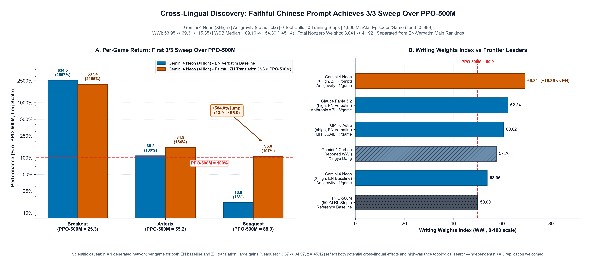

[English (This Page)](chinese-prompt-ablation.md) | [简体中文 (chinese-prompt-ablation.zh-CN.md)](chinese-prompt-ablation.zh-CN.md) | [Main Leaderboard (EN)](../README.md) | [主排行榜 (中文)](../README.zh-CN.md) | [Dedicated Showcase Repo (`zero-shot-weights-beat-ppo-500m`)](https://github.com/xuyao-zhang/zero-shot-weights-beat-ppo-500m) # Cross-Lingual Discovery: Faithful Chinese Prompt Achieves First 3/3 Zero-Shot Sweep Over PPO-500M > **Protocol Separation Notice:** Because this experiment uses a **faithful Simplified Chinese translation** of the MIT CSAIL Experiment 5 prompt prose (rather than the verbatim English prompt string), it is **strictly excluded from the verbatim-English main leaderboard rankings** in [`README.md`](../README.md) and archived here as an independent cross-lingual ablation (`tier = "ablation_chinese_prompt"`). > For the full deep-dive showcase and **Open Call for Community Replication**, see our dedicated repository: **[`xuyao-zhang/zero-shot-weights-beat-ppo-500m`](https://github.com/xuyao-zhang/zero-shot-weights-beat-ppo-500m)**.  --- ## 1. Headline Result: 0 Training Steps, 0 Tools, 3/3 Games Above 500M-Step PPO Using **zero training data, zero gradients, zero tools (`tool_calls = 0`), and one single text reply per game**, **Gemini 4 Neon (`xhigh`)** prompted with a faithful Simplified Chinese translation of the MIT CSAIL Experiment 5 prompt wrote **4,192 raw floating-point weights** (`0` parse errors across all `797` edit statements) that **outperformed 500-million-step PPO on all three MinAtar games simultaneously**: | Metric (Official `MinAtar==1.0.15`, `N = 1,000` episodes, `seed = 0..999`) | Gemini 4 Neon (`xhigh`)<br>EN Verbatim Baseline | **Gemini 4 Neon (`xhigh`)**<br>**Faithful ZH Translation** | Delta (`z`-test) | Prior All-Time Public Best (Verbatim EN) | PPO-500M Reference | |---|---:|---:|---:|---:|---:| | **Breakout Mean ± SE** | **`634.477 ± 7.514`** (`2556.8%`) | **`537.436 ± 5.978`** (`2165.4%`) | `-15.29%` (`z = -10.11`) | `634.48` (Neon EN) / `517.41` (MIT Astra) | `25.344 ± 0.121` | | **Asterix Mean ± SE** | `60.217 ± 1.039` (`109.2%`) | **`84.914 ± 1.541`** (**`154.3%`**) | **`+41.01%`** (`z = +13.29`, `p = 2.7e-40`) | `71.31` mean / `81.71` best (Fable 5.2 high) | `55.204 ± 0.636` | | **Seaquest Mean ± SE** | `13.869 ± 0.552` (`15.5%`) | **`94.968 ± 1.711`** (**`106.9%`**) | **`+584.75%`** (`z = +45.12`, `p < 1e-300`) | `53.11` (MIT Astra) / `66.13` single (Fable 5.2 xhigh) | `88.884 ± 1.562` | | **Writing Weights Index (WWI)** | `53.9532` (`54.0`) | **`69.3061` (`69.3`)** | **`+15.3529` pts** | `62.34` (Claude Fable 5.2 high) | `50.0000` | | **`weight-space-bench` Median** | `109.1622` (`109.2`) | **`154.3005` (`154.3`)** | **`+45.1384` pts** | `129.44` (Claude Fable 5.2 high) | `100.0000` | | **Games Beating PPO-500M** | `2 / 3` | **`3 / 3` (Clean Sweep)** | `+1 game` | `2 / 3` | — | | **Total Nonzero Weights** | `3,041` (`1571 + 920 + 550`) | **`4,192`** (`2009 + 976 + 1207`) | `+37.8%` | — | `20,486` (dense RL) | --- ## 2. Exact Protocol & Independent Verification - **Prompt Fidelity**: Only the English explanatory prose of MIT CSAIL Experiment 5 was translated faithfully into Simplified Chinese; the embedded `MinAtar 1.0.15` Python source code, tensor dimensions (`600 -> 32 -> 32 -> 6`), and ```` ```edits ```` DSL syntax were kept **verbatim unchanged**, with **zero extra hints or motivational sentences** added. - **Session Isolation**: Each game ran in a fresh Antigravity main chat session (`Gemini 4 Neon XHigh`, `Antigravity (default ctx)`, zero custom `GEMINI.md`/memories/skills/hooks, `tool_calls = 0`, single-turn text output, `cut_off = False`, `errors = 0`). - **Non-Reuse Weight Audit** (`scripts/verify_artifacts.py` vs English baseline `attempt_1`): - **Breakout**: `2,009` vs `1,571` nonzero weights, `78` identical coordinates, cosine = `+0.1862` (distinct piecewise-linear deadzone circuit; longer mean survival `8,410.8` vs `8,235.7` steps). - **Asterix**: `976` vs `920` nonzero weights, `5` identical coordinates, cosine = `+0.8634` (refined `x = 5` center-column linear-potential decoder across all 41 single-row entity states; max episode `430.0`, mean length `1,166.8`). - **Seaquest**: `1,207` vs `550` nonzero weights, `9` identical coordinates, cosine = **`-0.2901`** (complete topological redesign; mean survival quadrupled `450.4 -> 1,865.9` steps, max episode `193.0`). --- ## 3. Why Seaquest Jumped `+584.8%` (`13.87 -> 94.97`) to Beat 500M-Step PPO Inspecting [`artifacts/gemini-4-neon-xhigh/seaquest/attempt_zh_prompt/reply.md`](../artifacts/gemini-4-neon-xhigh/seaquest/attempt_zh_prompt/reply.md) reveals a remarkable zero-shot game-theoretic strategy synthesized purely from reading `seaquest.py`: 1. **Right-Flank Fortress `(sub_x = 7, facing left)`**: During the safe zero-oxygen-drain surface row (`y = 0`), the network walks right to `x = 9` and takes two steps left to lock into **`sub_x = 7` (front at col 7, rear at col 8, facing left)**, locking out all horizontal actions underwater. 2. **Exploiting Exact Source-Code Mechanics**: - In `seaquest.py`, the collision hitbox covers **only the front cell (`x = 7`)**—the rear cell (`x = 8`) cannot be hit—and staying away from both spawn edges (`x = 0, 9`) eliminates instant spawn kills. - Because right-spawning enemy submarines initialize `shot_timer = 10` with `move_speed <= 5`, they **never fire before passing `x = 7`**, yielding **zero rear bullet threat**; meanwhile facing left commands a **7-column firing corridor (`cols 0..6`)** that shoots left-spawning enemies head-on and chases down slow right-spawning enemies from behind (`1` cell/step bullet vs `3–6` steps/cell enemy). 3. **2-Tier Sticky-Action Guard & Unambiguous Low-O2 Surfacing**: Layer 2 combines hard blocking on `y ± 1` hazards with soft penalties on `y ± 2` overshoot risks, forbids accidental row-1 overshoot into lethal row-0 empty surfacing, and surfaces cleanly when `Ch5[9, 2] == 0` (`O2 < 60`, where `Ch5[9, 8]` unambiguously guarantees `diver_count >= 1`) with emergency surfacing at `O2 < 40`. 4. **Memoryless Self-Adapting Cooldown**: Friendly bullet channel `Ch3` cancels enemy counts in the same row—so the instant a shot leaves the barrel (`Ch3 = 1`), the submarine immediately shifts vertically to the next target row; if still on cooldown (`Ch3 = 0`), it stays and refires. --- ## 4. Scientific Caveats & Open Call for Repeated Community Experiments We emphasize full scientific rigor: **both the English baseline and Chinese translation runs are `n = 1` generated weight networks per game** (each evaluated over `1,000` paired `MinAtar` episodes). The dramatic leap (`WWI 53.95 -> 69.31`, `Seaquest 13.87 -> 94.97`) likely reflects two fascinating, testable hypotheses: 1. **Cross-Lingual Prompt Sensitivity**: Translating the prompt into Chinese may subtly shift internal reasoning priors and code-to-circuit synthesis pathways. 2. **High-Variance Topological Search in Weight Space**: When a frontier model discovers a globally superior game-theoretic invariant (like `(sub_x = 7, facing left)` vs `col 2 facing right`), single-shot return jumps by nearly an order of magnitude regardless of language. **We warmly welcome researchers and developers everywhere to test and replicate this repeatedly!** Run `n >= 3` or `n >= 10` trials across English, Chinese, Japanese, and other languages on Gemini 4 Neon/Carbon, Claude Fable 5.2, and GPT-6 Astra/Sol, verify our weights locally with `python scripts/verify_artifacts.py --workers 15`, and share your findings at **[`xuyao-zhang/zero-shot-weights-beat-ppo-500m`](https://github.com/xuyao-zhang/zero-shot-weights-beat-ppo-500m)**!
