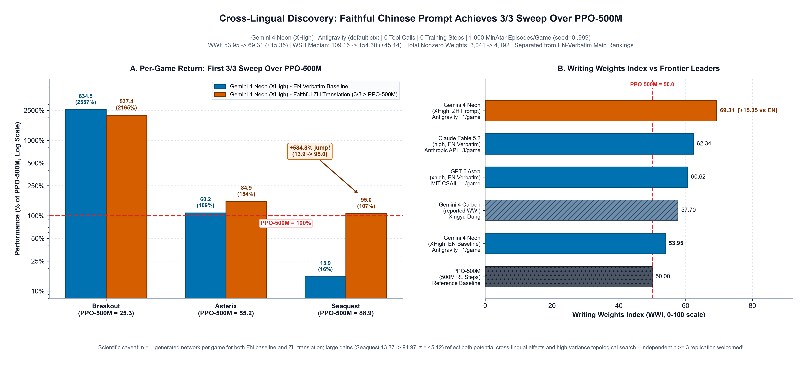

[简体中文 (当前页)](chinese-prompt-ablation.zh-CN.md) | [English (chinese-prompt-ablation.md)](chinese-prompt-ablation.md) | [主排行榜 (中文)](../README.zh-CN.md) | [Main Leaderboard (EN)](../README.md) | [独立专题展示仓库 (`zero-shot-weights-beat-ppo-500m`)](https://github.com/opopile/zero-shot-weights-beat-ppo-500m)

# 跨语言震撼发现：全中文直译提示词首次实现零样本三杀 PPO-500M

> **协议严格隔离说明**：由于本实验采用了 MIT CSAIL Experiment 5 提示词说明部分的**忠实简体中文直译**（而非原版英文字符串），为保持原版英文主榜口径的绝对纯净，本组结果**不混入 [`README.zh-CN.md`](../README.zh-CN.md) 原始英文主排行榜**，而是作为独立跨语言消融专题（`tier = "ablation_chinese_prompt"`）单列呈现。  
> 更完整的专题展示、一键验证与**全球社区反复实验号召**，请访问我们的全新专属仓库：**[`opopile/zero-shot-weights-beat-ppo-500m`](https://github.com/opopile/zero-shot-weights-beat-ppo-500m)**。



---

## 1. 核心战绩：0 步训练、0 工具调用，三款游戏全线击穿 5 亿步 PPO

在**零训练数据、零梯度更新、零工具调用（`tool_calls = 0`）、单轮纯文本输出**的严格条件下，**Gemini 4 Neon（`xhigh`）** 仅凭借忠实直译的中文提示词，一口气手写出 **4,192 个原始浮点权重**（全部 `797` 条赋值语句 **0 报错**），**在全部三款 MinAtar 游戏上同时击败了苦练 5 亿步的 PPO-500M**：

| 指标（官方 `MinAtar==1.0.15`，`N = 1,000` 回合，`seed = 0..999`） | Gemini 4 Neon (`xhigh`)<br>英文原版基线 | **Gemini 4 Neon (`xhigh`)**<br>**全中文直译复测** | 变化幅度（双样本 `z` 检验） | 此前全网公开最高（英文原版） | PPO-500M 基线 |
|---|---:|---:|---:|---:|---:|
| **Breakout 均分 ± SE** | **`634.477 ± 7.514`** (`2556.8%`) | **`537.436 ± 5.978`** (`2165.4%`) | `-15.29%` (`z = -10.11`) | `634.48`（英文 Neon）/ `517.41`（MIT Astra） | `25.344 ± 0.121` |
| **Asterix 均分 ± SE** | `60.217 ± 1.039` (`109.2%`) | **`84.914 ± 1.541`** (**`154.3%`**) | **`+41.01%`** (`z = +13.29`, `p = 2.7e-40`) | `71.31` 均值 / `81.71` 单次（Fable 5.2 high） | `55.204 ± 0.636` |
| **Seaquest 均分 ± SE** | `13.869 ± 0.552` (`15.5%`) | **`94.968 ± 1.711`** (**`106.9%`**) | **`+584.75%`** (`z = +45.12`, `p < 1e-300`) | `53.11`（MIT Astra）/ `66.13` 单次（Fable 5.2 xhigh） | `88.884 ± 1.562` |
| **Writing Weights Index (WWI)** | `53.9532` (`54.0`) | **`69.3061` (`69.3`)** | **`+15.3529` 分** | `62.34`（Claude Fable 5.2 high） | `50.0000` |
| **`weight-space-bench` 中位数** | `109.1622` (`109.2`) | **`154.3005` (`154.3`)** | **`+45.1384` 分** | `129.44`（Claude Fable 5.2 high） | `100.0000` |
| **超越 PPO-500M 游戏数** | `2 / 3` | **`3 / 3`（全线通杀）** | `+1 款` | `2 / 3` | — |
| **三游戏非零权重总数** | `3,041` (`1571 + 920 + 550`) | **`4,192`** (`2009 + 976 + 1207`) | `+37.8%` | — | `20,486`（稠密 RL） |

---

## 2. 严格实验协议与非复用核验

- **忠实直译无作弊**：仅将 MIT CSAIL Experiment 5 提示词中的英文文字说明忠实翻译为简体中文；内嵌的 `MinAtar 1.0.15` Python 游戏源码、张量维度（`600 -> 32 -> 32 -> 6`）与 ```` ```edits ```` 语法**一字未改**，且**未追加任何提示、技巧或激励语**。
- **洁净独立会话**：三款游戏分别在全新 Antigravity 主会话运行（`Gemini 4 Neon XHigh`，`Antigravity (default ctx)`，零自定义规则/记忆/技能/钩子，`tool_calls = 0`，单轮文本，`cut_off = False`，`errors = 0`）。
- **权重独立性核验**（`scripts/verify_artifacts.py` 对比英文原版 `attempt_1`）：
  - **Breakout**：`2,009` vs `1,571` 非零权重，相同坐标值 `78` 个，余弦相似度 `+0.1862`（独立重构凹凸分段线性抗粘滞死区电路，平均存活 `8,410.8` 步优于英文 `8,235.7` 步）。
  - **Asterix**：`976` vs `920` 非零权重，相同坐标值 `5` 个，余弦相似度 `+0.8634`（精化中路 `x = 5` 单神经元 41 状态线性势能解码器，单局最高 `430.0`，平均存活 `1,166.8` 步）。
  - **Seaquest**：`1,207` vs `550` 非零权重，相同坐标值 `9` 个，余弦相似度 **`-0.2901`**（彻底推倒重来的全新电路拓扑，平均存活步数暴增至 **`1,865.9` 步**，单局最高 `193.0`）。

---

## 3. 解密 Seaquest 暴涨 `+584.8%`（`13.87 -> 94.97`）干翻 5 亿步 PPO 的天才电路

审阅 [`artifacts/gemini-4-neon-xhigh/seaquest/attempt_zh_prompt/reply.md`](../artifacts/gemini-4-neon-xhigh/seaquest/attempt_zh_prompt/reply.md) 可见，Neon 仅凭阅读 `seaquest.py` 源码就零样本推演出了一套降维打击的**“右翼固定列 `(sub_x = 7, 朝左)` 堡垒”**：

1. **水面零耗氧精准卡位**：开局在第 0 行先右移至 `x = 9` 再左转两步，锁死在 **前端列 7、后端列 8、朝左** 的位姿，此后水下彻底封死左右移动，把二维博弈压缩为一维高精度纵向电路。
2. **吃透源码底层机制**：
   - `seaquest.py` 的受击碰撞盒**仅位于前端 `x = 7`**（后端 `x = 8` 完全不受击！），同时远离左右刷怪边（`x = 0, 9`），根绝贴脸秒杀；
   - 右侧 `x = 9` 刷出的敌潜艇 `shot_timer = 10`、`move_speed <= 5`，必在越过 `x = 7` 之后才开火——实现**零背后子弹威胁**；面朝左侧统治 **`0..6` 共 7 列超长射界**，左侧来敌迎面击杀，右侧来敌绕过 `x = 7` 后被每步 1 格的高速子弹从背后稳稳收割！
3. **双层抗粘滞过冲保护 + 零歧义低氧上浮**：第二层结合 `y ± 1` 硬阻断与 `y ± 2` 软警戒抵御 10% 粘滞动作误杀，禁止非上浮态误入第 1 行冲顶暴毙，并利用 `Ch5[9, 2] == 0`（氧气 `< 60`，此时 `Ch5[9, 8]` 数学上无歧义等价于 `diver_count >= 1`）触发精准上浮、`O2 < 40` 触发紧急上浮。
4. **无记忆冷却自适配射击**：用友方子弹通道 `Ch3` 自动抵消同行敌人计数——一旦成功发射出弹（`Ch3 = 1`），潜艇立刻转战下一行；若仍在 5 步冷却期（`Ch3 = 0`），自动留守补射。

---

## 4. 严谨科学声明与全球反复实验邀请

必须如实强调：**英文基线与中文直译实验目前各自均为 `n = 1` 次网络生成样本**（各在 `1,000` 个配对种子上评测）。如此惊人的跃升（`WWI 53.95 -> 69.31`、`Seaquest 13.87 -> 94.97`）背后可能由两大值得深入检验的假设驱动：
1. **跨语言提示词效应**：将复杂规则忠实译为中文，可能改变了前沿大模型内部的推理路径与代码到权重的编译偏好；
2. **权重空间的高方差拓扑采样**：在单轮生成中，模型一旦抽中全局更优的博弈几何不变式（如 `(x=7, 朝左)` 堡垒 vs `col 2 朝右`），零样本分数即可跨越一个数量级。

**我们热忱欢迎全球开发者与研究者一起反复实验、独立验证！** 只需运行 `python scripts/verify_artifacts.py --workers 15` 即可 60 秒本地复验全部权重分数，更欢迎大家用中/英/日等多语种在 Neon、Carbon、Fable 5.2、GPT-6 Astra 上跑 `n >= 3` 或 `n >= 10` 独立复现，并前往专属仓库 **[`opopile/zero-shot-weights-beat-ppo-500m`](https://github.com/opopile/zero-shot-weights-beat-ppo-500m)** 提交 Issue 或 PR 共同探索权重空间编程的边界！
