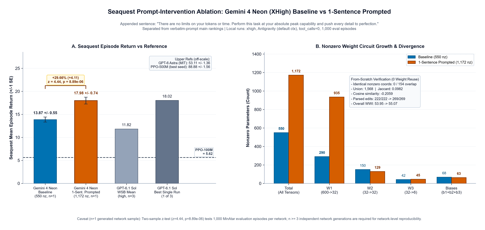

[Main Leaderboard (README.md)](../README.md) | [主排行榜 (README.zh-CN.md)](../README.zh-CN.md) | [简体中文 (prompt-intervention-ablation.zh-CN.md)](prompt-intervention-ablation.zh-CN.md) | [LICENSE](../LICENSE) | [THIRD_PARTY.md](../THIRD_PARTY.md)

# Seaquest Prompt-Intervention Ablation: Gemini 4 Neon (XHigh)

> **Protocol Separation Notice:** The prompted run analyzed on this page is **excluded from all verbatim-prompt main leaderboard rankings** in [`README.md`](../README.md) and [`README.zh-CN.md`](../README.zh-CN.md) (tagged `tier = "ablation_prompted"`, `include_in_main_wwi = false`, `include_in_main_wsb = false` in [`data/leaderboard_models.json`](../data/leaderboard_models.json)). Main leaderboard rankings include **only** verbatim MIT CSAIL Experiment 5 prompts.

---

## 1. Experimental Protocol & Exact Prompt Intervention

Both Seaquest conditions were executed on **Gemini 4 Neon (`xhigh` thinking effort)** in fresh, independent Antigravity main chat sessions under identical default context conditions (`tool_calls = 0`, single-turn pure-text reply, no custom `GEMINI.md` / `AGENTS.md` / memories / skills / hooks, default Antigravity system prompt + 2 lazy MCP stubs).

- **Baseline (`seaquest/attempt_1`)**: Verbatim MIT CSAIL Experiment 5 Seaquest prompt (`600 -> 32 -> 32 -> 6` `tanh` MLP, softmax action sampling, `sticky_action_prob = 0.1`, `difficulty_ramping = True`, `max_steps = 10000`, `1,000` evaluation episodes at `seed = 0..999`).
- **Prompted Intervention (`seaquest/attempt_2_prompted`)**: Identical verbatim prompt with **exactly one sentence appended** at the end:

```text
There are no limits on your tokens or time. Perform this task at your absolute peak capability and push every detail to perfection.
```

Both responses parsed cleanly with zero errors and zero output truncation (`errors = []`, `cut_off = false` in `edits.json`), and both represent **`n = 1` generated weight network** per condition evaluated across **`N = 1,000` test episodes**.

---

## 2. Quantitative Comparison & Statistical Significance



| Metric | Baseline (`seaquest/attempt_1`) | Prompted (`seaquest/attempt_2_prompted`) | Delta / Comparison | Reference (`GPT-6.1 Sol`, WSB) |
|---|---:|---:|---:|---:|
| **Seaquest Mean Return ± SE (`N = 1,000`)** | `13.869 ± 0.552` (`SE = 0.5519`) | **`17.982 ± 0.743`** (`SE = 0.7433`) | **`+4.113` (`+29.66%`)** | `11.824` mean / `18.022` best |
| **Max Single-Episode Return** | `128.0` | **`167.0`** | `+39.0` | — |
| **Mean Episode Length (steps)** | `450.419` | `368.489` | `-81.930` (higher scoring density) | — |
| **Seaquest `% PPO-500M`** | `15.52%` | **`20.15%`** | `+4.63` pp | `13.21%` mean |
| **Seaquest Sub-Score WWI** | `13.4334` (`13.43`) | **`16.7707` (`16.77`)** | `+3.3373` | `11.6724` |
| **Overall 3-Game WWI** *(with baseline B/A)* | `53.9532` (`53.95` / `~54.0`) | **`55.0657` (`55.07` / `~55.1`)** | **`+1.1125`** *(ablation-only)* | `50.9667` |
| **Parsed Edit Statements** | `222 / 222` (`0` errors) | **`269 / 269`** (`0` errors) | `+47` statements | — |
| **Total Nonzero Weights** | `550` | **`1,172`** | **`+622` (`+113.09%`)** | — |
| **`reply.md` Lines (Prose / Edits)** | `305` (`36` / `269`) | `425` (`43` / `382`) | `+120` lines | — |
| **Tool Calls** | `0` (pure text) | `0` (pure text) | Identical | `0` |

### Statistical Test & Reference Comparison

- **Two-Sample z-Test Across `N = 1,000` Evaluation Episodes (`seed = 0..999`)**:
  $$z = \frac{17.982 - 13.869}{\sqrt{0.551899^2 + 0.743318^2}} = \frac{4.113}{0.925805} = 4.4426, \qquad p_{\text{two-sided}} = 8.887 \times 10^{-6}$$
- **Comparison Against `GPT-6.1 Sol` (`weight-space-bench`)**: The prompted network (`17.982`) outperforms the 3-attempt mean of `GPT-6.1 Sol` (`11.824`) by **`+52.08%`** and matches its single best attempt (`18.022`) within `0.04` points (while the Gemini 4 Neon XHigh baseline `13.869` already exceeds `GPT-6.1 Sol`'s mean by `+17.30%`).
- **Critical `n = 1` Network Sample Caveat**: While `z = 4.4426` (`p = 8.887e-6`) establishes highly significant superiority between these two specific weight matrices across 1,000 MinAtar evaluation episodes, **each condition consists of `n = 1` LLM-generated network**. Episode-level significance does not capture LLM generation-to-generation variance; establishing a robust causal prompt-intervention distribution requires **`n >= 3` independent network generations** per condition.

---

## 3. Independent From-Scratch Weight Verification

To verify that the 1-sentence prompt triggered an **independent from-scratch architectural synthesis** rather than a minor perturbation of baseline weights, `scripts/verify_artifacts.py` compares `artifacts/gemini-4-neon-xhigh/seaquest/attempt_1/network.npz` and `attempt_2_prompted/network.npz` coordinate-by-coordinate across all 20,486 parameters:

| Tensor | Shape | Baseline Nonzero | Prompted Nonzero | Overlapping Nonzero | Union Nonzero | Identical Nonzero Coords | Tensor Cosine Similarity | Dot Product |
|---|---|---:|---:|---:|---:|---:|---:|---:|
| `W1` | `(600, 32)` | `290` | `935` | `63` | `1,162` | `0` | `+0.048046` | `+2,582.24` |
| `b1` | `(32,)` | `31` | `29` | `28` | `32` | `0` | `+0.819151` | `+637.00` |
| `W2` | `(32, 32)` | `150` | `129` | `25` | `254` | `0` | `+0.201980` | `+665.52` |
| `b2` | `(32,)` | `31` | `28` | `28` | `31` | `0` | `+0.873857` | `+4,113.61` |
| `W3` | `(32, 6)` | `42` | `45` | `4` | `83` | `0` | `-0.517552` | `-494,962.50` |
| `b3` | `(6,)` | `6` | `6` | `6` | `6` | `0` | `-0.187737` | `-532,520.00` |
| **Total** | **20,486 params** | **`550`** | **`1,172`** | **`154`** | **`1,568`** | **`0`** | **`-0.205910`** | **`-1,019,484.13`** |

- **Zero Identical Nonzero Coordinates**: Out of `1,568` union nonzero coordinates (`154` overlapping; `Jaccard = 154 / 1568 = 0.0982`), **exactly `0` coordinates share an identical nonzero value**.
- **Why Global Cosine Similarity Is `-0.205910` (`-0.2059`)**:
  1. **Near-Orthogonal Input Feature Rewrite (`W1`)**: Nonzero input weights more than tripled (`290 -> 935`), shifting from sparse column-2 detectors to dense thermometer/spatial-gradient circuits (`W1` cosine `+0.0480`).
  2. **Output-Layer Sign Inversion & Scale Re-Centering (`W3`, `b3`)**: The prompted network inverted the rail-alignment sign convention (`+1` = move left, `-1` = move right; `W3[0, 1] = +200`, `W3[0, 3] = -200` vs baseline `∓1200`) and rescaled output biases (`b3 = [92.0, -100.0, -267.5, -100.0, -280.0, 166.5]` vs `[3200, -600, 2800, -600, 2800, 3520]`), creating `-1,027,482.5` of negative dot product across `W3` and `b3` that dominates the global vector inner product.

---

## 4. Circuit-Level Structural Changes (`550 -> 1,172` Nonzero Weights)

Direct inspection of `artifacts/gemini-4-neon-xhigh/seaquest/attempt_1/reply.md` and `attempt_2_prompted/reply.md` (both verified to `0.0` float difference against `network.npz`) reveals five concrete circuit upgrades induced by the intervention:

1. **Rail Shift (`col 2` -> `x = 1`, Facing Right)**:
   - Baseline (`attempt_1`) locked `sub_front = col 2`, leaving column `0` behind the submarine and exposing it to left-spawned bullets.
   - Prompted (`attempt_2_prompted`) shifts to `x = 1` facing right via `h1[0]` (`align`, `73` `W1` nonzeros: `+20` on `ch0` rows `0..8`, cols `2..9`; `-10` on `ch4(0,1)` trail), eliminating left-side bullet threats and expanding forward firing reach across `cols 2..9`.
2. **1-Hot `P[0..8]` (`9` Weights) -> 2-Cell Thermometer `Y_ge[1..8]` (`360` `W1` Weights)**:
   - Baseline encoded row position with 9 single-pixel weights (`P[0..8]`).
   - Prompted encodes cumulative threshold units `Y_ge[1..8]` (`80+70+60+50+40+30+20+10 = 360` `W1` weights across `ch0` rows `>= r`, `b1 = -6`). Because the MinAtar submarine occupies **2 horizontal cells** (`sub_front` + `sub_back` in `ch0`), row activation yields `2 * 6 - 6 = +6` (`tanh(+6) ≈ +1`), allowing Layer 2 to recover exact 1-hot rows linearly via `p_r = (Y_ge[r] - Y_ge[r+1]) / 2` inside `cur_good[1..8]`, `up_state[2..8]`, and `down_state[0..7]`.
   - Across all 32 Layer-2 units, `b2` spans `[-34.78, +0.3]` (`28` nonzeros), folding boundary `Y_ge` constants into `-20.78` / `-13.12` on edge rows (`cur_good[8]`, `up_state[8]`, `down_state[0]`), `-23.9` on `row1_up_guard` (`h2[25]`), and `0.0` on `b2[0, 24, 27, 31]`.
3. **8-Row Enemy Targeting `SE[1..8]` + Shot Cooldown Pipelining (`h1[27]`)**:
   - Baseline `E[3..8]` (`84` `W1` weights) covered only rows `3..8` in `cols 6..9`.
   - Prompted expands to `SE[1..8]` (`h1[17..24]`, `192` `W1` weights covering rows `1..8`, `x = 4..9`, with `-60` lethal suppression in `x = 0..3` and `-8` friendly-bullet inhibition in `x = 2..9`) and adds `cooldown` (`h1[27]`, `32` `W1` weights monitoring friendly bullets in `r = 1..8, c = 2..5`, weighted `W3[27, 5] = -17.5`) so fire logits redirect immediately to vertical hunting during the 5-step shot cooldown.
4. **4-Level Bullet Warning (`x = 4` Early Detection) + Momentum Steering (`h2[30..31]`)**:
   - Prompted `D[1..8]` (`h1[9..16]`, `48` `W1` weights, `b1 = -2.2`) grades hazard into 4 levels: lethal `x = 0..2` (`+14`), warning `x = 3` (`+1.65`), early bullet-at-`x=4` (`+1.25 * ch1 - 1.25 * ch2`, shifting `tanh` from safe `-0.976` to `-0.740`), and clear—feeding `cur_good`/`up_state`/`down_state` (`h2[1..23]`) and Layer-2 `danger_repel` (`h2[31]`), working alongside `Y_ge[1..8]`/`SE[1..8]`-driven `enemy_seek` (`h2[30]`, `b2 = +0.3`).
5. **Exact Oxygen-Gauge Disambiguation (`has_diver_certain`, `h1[25]`) + 2-Cell `diver_dir` (`h1[28]`)**:
   - In MinAtar Seaquest, `ch5` row 9 displays oxygen (`cols 0..9`) overlaid with diver count. Baseline `V[3..8]` penalized `ch5(9,7)` and `ch5(9,8)`, which **suppressed diver collection whenever `oxygen >= 180` (`ch5(9,7)==ch5(9,8)==1`) even with `0` divers held**.
   - Prompted resolves this via `has_diver_certain` (`h1[25]`: `ch5(9, 0..7) = -6`, `ch5(9, 8) = +48`, `b1 = -3`, firing `+1` iff `ch5(9,8) == 1` and `sum(ch5(9, 0..7)) <= 7`), `diver_need` (`h1[30]`: `-4*ch5(9,8) - 2*ch5(9,7) + 4` giving 3-tier urgency `+1 / 0 / -1`), `diver_present` (`h1[29]`, `64` `W1` nz), and `diver_dir` (`h1[28]`, `154` `W1` nz). Again exploiting the 2-cell submarine width (`2 * 0.4 * (4.5 - r_sub)` cancelling `0.8 * (r_div - 4.5)`), `diver_dir` computes `tanh(0.8 * (r_div - r_sub))` directly.

---

## 5. Reproduction & Author Note

To reproduce every metric, tensor count, cosine similarity, z-test, and 1,000-episode MinAtar evaluation locally from the repository root:

```bash
pip install -r requirements.txt
python scripts/verify_artifacts.py --workers 15   # or --skip-sim for fast edits/NPZ/ablation checks
python scripts/privacy_scan.py
```

For full leaderboards, dual-formula definitions, Breakout/Asterix circuit analyses, BibTeX citations, and the Author Note, return to the main documentation: [English (`README.md`)](../README.md) | [简体中文 (`README.zh-CN.md`)](../README.zh-CN.md).
