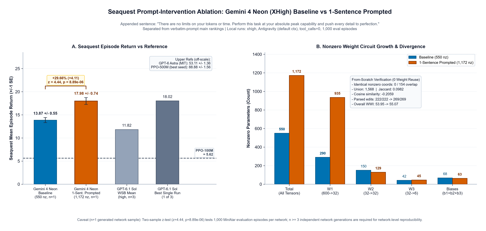

[主排行榜 (README.zh-CN.md)](../README.zh-CN.md) | [Main Leaderboard (README.md)](../README.md) | [English (prompt-intervention-ablation.md)](prompt-intervention-ablation.md) | [LICENSE](../LICENSE) | [THIRD_PARTY.md](../THIRD_PARTY.md)

# Seaquest 提示词干预消融实验：Gemini 4 Neon (XHigh)

> **协议隔离声明：** 本页分析的提示词干预运行结果**严格不纳入主排行榜的原始提示词（verbatim-prompt）排名**（在 [`data/leaderboard_models.json`](../data/leaderboard_models.json) 中标记为 `tier = "ablation_prompted"`、`include_in_main_wwi = false`、`include_in_main_wsb = false`）。[`README.md`](../README.md) 与 [`README.zh-CN.md`](../README.zh-CN.md) 的主排行榜仅包含严格使用 MIT CSAIL Experiment 5 原始提示词的模型结果。

---

## 1. 实验协议与精确提示词干预

两组 Seaquest 实验均在 **Gemini 4 Neon（`xhigh` 思考强度）** 上执行，分别在全新的 Antigravity 主聊天会话中以相同默认上下文条件完成（`tool_calls = 0`、单轮纯文本回复、无自定义 `GEMINI.md` / `AGENTS.md` / memories / skills / hooks，仅保留默认 Antigravity 系统提示词及 2 个惰性 MCP 存根）。

- **基线组（`seaquest/attempt_1`）**：严格使用 MIT CSAIL Experiment 5 Seaquest 原始提示词（`600 -> 32 -> 32 -> 6` `tanh` 多层感知机、softmax 动作采样、`sticky_action_prob = 0.1`、`difficulty_ramping = True`、`max_steps = 10000`、`seed = 0..999` 共 `1,000` 回合评估）。
- **提示词干预组（`seaquest/attempt_2_prompted`）**：在完全相同的原始提示词末尾**仅追加以下一句英文**：

```text
There are no limits on your tokens or time. Perform this task at your absolute peak capability and push every detail to perfection.
```

两组响应均完整解析且未发生截断（`edits.json` 中 `errors = []`、`cut_off = false`）。每组均代表 **`n = 1` 个独立生成的权重网络样本**，并在 **`N = 1,000` 个测试回合**上进行评估。

---

## 2. 定量对比与统计显著性检验



| 指标 | 基线组 (`seaquest/attempt_1`) | 干预组 (`seaquest/attempt_2_prompted`) | 差值 / 对比 | 参考基准 (`GPT-6.1 Sol`, WSB) |
|---|---:|---:|---:|---:|
| **Seaquest 平均回报 ± SE（`N = 1,000`）** | `13.869 ± 0.552` (`SE = 0.5519`) | **`17.982 ± 0.743`** (`SE = 0.7433`) | **`+4.113` (`+29.66%`)** | `11.824` 均值 / `18.022` 最佳单次 |
| **单回合最高得分** | `128.0` | **`167.0`** | `+39.0` | — |
| **平均回合长度（步数）** | `450.419` | `368.489` | `-81.930`（得分密度显著提高） | — |
| **Seaquest `% PPO-500M`** | `15.52%` | **`20.15%`** | `+4.63` 百分点 | `13.21%` 均值 |
| **Seaquest 单项 WWI** | `13.4334` (`13.43`) | **`16.7707` (`16.77`)** | `+3.3373` | `11.6724` |
| **三游戏综合 WWI** *（Breakout/Asterix 取基线）* | `53.9532` (`53.95` / `~54.0`) | **`55.0657` (`55.07` / `~55.1`)** | **`+1.1125`** *（仅消融参考）* | `50.9667` |
| **成功解析的编辑语句数** | `222 / 222`（`0` 错误） | **`269 / 269`**（`0` 错误） | `+47` 条 | — |
| **总非零权重数量** | `550` | **`1,172`** | **`+622` (`+113.09%`)** | — |
| **`reply.md` 行数（说明 / 编辑）** | `305` (`36` / `269`) | `425` (`43` / `382`) | `+120` 行 | — |
| **工具调用次数** | `0`（纯文本） | `0`（纯文本） | 相同 | `0` |

### 统计显著性与外部参考对比

- **`N = 1,000` 评估回合的双样本 z 检验（`seed = 0..999`）**：
  $$z = \frac{17.982 - 13.869}{\sqrt{0.551899^2 + 0.743318^2}} = \frac{4.113}{0.925805} = 4.4426, \qquad p_{\text{two-sided}} = 8.887 \times 10^{-6}$$
- **与 `GPT-6.1 Sol`（`weight-space-bench`）对比**：干预组（`17.982`）相比 `GPT-6.1 Sol` 三次运行均值（`11.824`）高出 **`+52.08%`**，并已逼近其三次中最佳单次运行（`18.022`，仅差 `0.04` 分）；即便未加提示词干预的基线组（`13.869`）也比 `GPT-6.1 Sol` 均值高出 `+17.30%`。
- **严格的 `n = 1` 生成样本局限性声明**：`z = 4.4426`（`p = 8.887e-6`）证明了这两个特定权重网络在 1,000 个 MinAtar 评估回合上的差异具有高度统计显著性，但**每个条件仅包含 `n = 1` 个大模型生成样本**。回合级统计检验无法反映模型多次独立生成间的采样方差；严谨确立提示词干预的分布级因果效应仍需每个条件至少 **`n >= 3` 次独立生成复现**。

---

## 3. 从零生成独立性验证

为验证单句提示词干预是否真正促成了**从零重构的独立权重架构**（而非在基线权重上微调），`scripts/verify_artifacts.py` 对 `artifacts/gemini-4-neon-xhigh/seaquest/attempt_1/network.npz` 与 `attempt_2_prompted/network.npz` 全部 20,486 个参数执行逐坐标比对：

| 张量 | 形状 | 基线非零数 | 干预非零数 | 重叠非零坐标数 | 并集非零坐标数 | 完全相同的非零坐标数 | 张量余弦相似度 | 内积 (Dot) |
|---|---|---:|---:|---:|---:|---:|---:|---:|
| `W1` | `(600, 32)` | `290` | `935` | `63` | `1,162` | `0` | `+0.048046` | `+2,582.24` |
| `b1` | `(32,)` | `31` | `29` | `28` | `32` | `0` | `+0.819151` | `+637.00` |
| `W2` | `(32, 32)` | `150` | `129` | `25` | `254` | `0` | `+0.201980` | `+665.52` |
| `b2` | `(32,)` | `31` | `28` | `28` | `31` | `0` | `+0.873857` | `+4,113.61` |
| `W3` | `(32, 6)` | `42` | `45` | `4` | `83` | `0` | `-0.517552` | `-494,962.50` |
| `b3` | `(6,)` | `6` | `6` | `6` | `6` | `0` | `-0.187737` | `-532,520.00` |
| **总计** | **20,486 参数** | **`550`** | **`1,172`** | **`154`** | **`1,568`** | **`0`** | **`-0.205910`** | **`-1,019,484.13`** |

- **完全相同的非零坐标数为 `0`**：在 `1,568` 个非零坐标并集中（`154` 个坐标重叠；`Jaccard = 154 / 1568 = 0.0982`），**没有任何一个坐标（`0` 个）具有相同的非零数值**。
- **全局余弦相似度为何为 `-0.205910`（`-0.2059`）**：
  1. **输入特征层近正交重写（`W1`）**：输入权重非零数增至 3 倍以上（`290 -> 935`），从稀疏的第 2 列检测器转向稠密温度计与空间梯度电路（`W1` 余弦相似度仅 `+0.0480`）。
  2. **输出层符号约定反转与默认偏置重定心（`W3`、`b3`）**：干预组反转了轨道对齐神经元 `align` 的动作符号约定（`+1` = 向左，`-1` = 向右；`W3[0, 1] = +200`、`W3[0, 3] = -200`，而基线组为 `∓1200`）并大幅重定心输出偏置（`b3 = [92.0, -100.0, -267.5, -100.0, -280.0, 166.5]` 对比 `[3200, -600, 2800, -600, 2800, 3520]`），在 `W3` 与 `b3` 上产生 `-1,027,482.5` 的负内积，从而主导全局余弦呈负值。

---

## 4. 电路结构重构分析（`550 -> 1,172` 非零权重）

对 `artifacts/gemini-4-neon-xhigh/seaquest/attempt_1/reply.md` 与 `attempt_2_prompted/reply.md`（均已验证与 `network.npz` 浮点误差为 `0.0`）的逐行解析揭示了干预带来的五项核心电路升级：

1. **防线左移（`col 2` -> `x = 1`，面朝右侧）**：
   - 基线组（`attempt_1`）将潜艇前端锁定在 `col 2`，导致左侧留出 `col 0` 空隙易受左侧刷新子弹攻击。
   - 干预组（`attempt_2_prompted`）改用 `h1[0]`（`align`，`73` 个 `W1` 非零权重：`ch0` 第 `0..8` 行第 `2..9` 列取 `+20`，`ch4(0,1)` 轨迹取 `-10`）将潜艇稳固锁定在最左有效列 `x = 1` 且面朝右侧，彻底消除左侧子弹威胁并将右侧射击覆盖面拓展至 `cols 2..9`。
2. **从 One-Hot `P[0..8]`（`9` 权重）升级为双格温度计编码 `Y_ge[1..8]`（`360` 个 `W1` 权重）**：
   - 基线组仅用 9 个单像素权重编码行坐标 `P[0..8]`。
   - 干预组改用累积阈值温度计 `Y_ge[1..8]`（`80+70+60+50+40+30+20+10 = 360` 个 `W1` 权重，偏置 `b1 = -6`）。由于 MinAtar 中潜艇在 `ch0` 恰好占据 **2 个水平格子**（`sub_front` 与 `sub_back`），当 `sub_y >= r` 时总输入恰好为 `2 * 6 - 6 = +6`（`tanh(+6) ≈ +1`），使第二层可通过线性差分 `p_r = (Y_ge[r] - Y_ge[r+1]) / 2` 精确提取 One-Hot 行选通信号（`cur_good[1..8]`、`up_state[2..8]`、`down_state[0..7]`）。
   - 第二层偏置 `b2` 跨度为 `[-34.78, +0.3]`（`28` 个非零值），其中边界多路复用单元（`cur_good[8]`、`up_state[8]`、`down_state[0]`）折叠常量偏置至 `-20.78` / `-13.12`，`row1_up_guard`（`h2[25]`）为 `-23.9`，`b2[0, 24, 27, 31]` 为 `0.0`。
3. **8 行全覆盖目标锁定 `SE[1..8]` + 发射冷却流水线 `cooldown`（`h1[27]`）**：
   - 基线组 `E[3..8]`（`84` 个 `W1` 权重）仅覆盖第 `3..8` 行第 `6..9` 列。
   - 干预组拓展为全 8 行检测 `SE[1..8]`（`h1[17..24]`，`192` 个 `W1` 权重覆盖第 `1..8` 行 `x = 4..9`，并在 `x = 0..3` 施加 `-60` 危险抑制、在 `x = 2..9` 对友方子弹施加 `-8` 抑制），同时新增 `cooldown`（`h1[27]`，`32` 个 `W1` 权重监测 `r = 1..8, c = 2..5` 的友方子弹，并以 `W3[27, 5] = -17.5` 抑制无效连发），在 5 步射击冷却窗口内立即转为纵向走位，使平均回合长度缩短（`450.4 -> 368.5`）而得分提高 `+29.66%`。
4. **4 级子弹预警（新增 `x = 4` 提前探测）+ 纵向惯性协同（`h2[30..31]`）**：
   - 干预组 `D[1..8]`（`h1[9..16]`，`48` 个 `W1` 权重，`b1 = -2.2`）构建四级危险度：贴脸必杀 `x = 0..2`（`+14`）、预警 `x = 3`（`+1.65`）、新增提前一格子弹预警 `x = 4`（`+1.25 * ch1 - 1.25 * ch2`，净输入 `-0.95 -> tanh = -0.740`，显著区分于安全状态 `-0.976`）以及安全状态；该组信号直接馈入 `cur_good`/`up_state`/`down_state`（`h2[1..23]`）与第二层 `danger_repel`（`h2[31]`），并与由 `Y_ge[1..8]`/`SE[1..8]` 驱动的 `enemy_seek`（`h2[30]`，`b2 = +0.3`）协同微调纵向权重。
5. **精确消除氧气条叠加歧义（`has_diver_certain`, `h1[25]`）与双格校准 `diver_dir`（`h1[28]`）**：
   - MinAtar Seaquest 中 `ch5` 第 9 行同时叠加显示氧气量（`cols 0..9`）与已救潜水员计数。基线组 `V[3..8]` 直接惩罚 `ch5(9,7)` 与 `ch5(9,8)`，导致**当氧气 `>= 180`（`ch5(9,7)==ch5(9,8)==1`）时即使船上仅有 `0` 名潜水员也会被误判抑制救援**。
   - 干预组通过 `has_diver_certain`（`h1[25]`：`ch5(9, 0..7) = -6`、`ch5(9, 8) = +48`、`b1 = -3`，仅当 `ch5(9,8) == 1` 且 `sum(ch5(9, 0..7)) <= 7` 时输出 `+1`）彻底解决满氧歧义，并配合 3 档 `diver_need`（`h1[30]`：`+1 / 0 / -1`）、`diver_present`（`h1[29]`，`64` 个 `W1` 权重）与双格校准的 `diver_dir`（`h1[28]`，`154` 个 `W1` 权重：利用 2 格船宽使 `2 * 0.4 * (4.5 - r_sub)` 与 `0.8 * (r_div - 4.5)` 精确抵消，直接计算 `tanh(0.8 * (r_div - r_sub))`）。

---

## 5. 复现方式与关于作者

在仓库根目录执行以下命令即可完整复现所有参数核验、余弦与独立性指标、双样本 z 检验及 1,000 回合 MinAtar 仿真：

```bash
pip install -r requirements.txt
python scripts/verify_artifacts.py --workers 15   # 或加 --skip-sim 快速校验编辑与网络一致性
python scripts/privacy_scan.py
```

完整双公式排行榜、Breakout / Asterix 权重电路分析、BibTeX 引用及“关于作者”请参见主文档：[简体中文 (`README.zh-CN.md`)](../README.zh-CN.md) | [English (`README.md`)](../README.md)。
